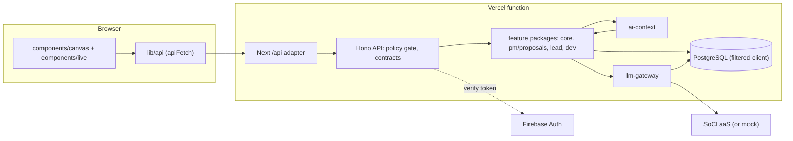
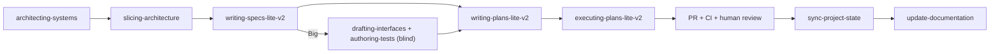

# Easel Developer Guide

This guide is for developers who maintain or extend Easel. It describes the system as released from the `development` branch, how it was built, and in depth the two additional requirements this project focuses on: **Context Engineering and Resource-aware Use** ([section 6](#6-context-engineering-and-resource-aware-use)) and **Multi-Agent Software Engineering** ([section 7](#7-multi-agent-software-engineering)).

For how to use the app, see the [User Guide](UserGuide.md). The living, per-workstream handover notes are in [`docs/guide/`](guide/index.md); the project's state, decisions (`C`-numbers) and deviations (`D`-numbers) are in [`workflow/project-state/`](../workflow/project-state/STATE.md); architecture decisions (`AD`-numbers) are in [`docs/architecture/decision-log.md`](architecture/decision-log.md).

- [1. Overview](#1-overview)
- [2. Setting up](#2-setting-up)
- [3. Architecture](#3-architecture)
- [4. Components](#4-components)
- [5. AI features](#5-ai-features)
- [6. Context Engineering and Resource-aware Use](#6-context-engineering-and-resource-aware-use)
- [7. Multi-Agent Software Engineering](#7-multi-agent-software-engineering)
- [8. Security](#8-security)
- [9. Testing](#9-testing)
- [10. Deployment](#10-deployment)
- [11. Known limitations](#11-known-limitations)
- [12. Acknowledgements](#12-acknowledgements)

---

## 1. Overview

Easel is a Scrum project platform with one or more LLM features per role:

| Role | What they do | AI feature |
|---|---|---|
| Project Manager | creates projects, plans the work | **Plan with AI**: outline (approach, checkpoints, epics), then expand each epic into tasks |
| Dev Lead | runs backlog, board, sprints; adds Developers | **Health digest**: explains facts that code computes (progress, velocity, checkpoint risk, overload) |
| Developer | works on assigned tasks | **Activity summaries** of uploaded commits and PRs, and the **daily standup** built from them |

**Stack:** a TypeScript monorepo. Next.js 16 (App Router) serves the UI and mounts a Hono API under `/api`. Prisma 7 talks to PostgreSQL (Neon). Firebase Authentication signs users in; the server verifies ID tokens with `firebase-admin`. Models are called through NUS SoCLaaS (an OpenAI-compatible endpoint). The app is deployed on Vercel.

**Repository layout:**

| Path | What it holds |
|---|---|
| `src/fe` | Next.js app: catch-all page, canvas page layouts, live components, `lib/api` data layer, `lib/auth` |
| `src/be/contracts` | Zod schemas, error shapes, route definitions, the policy map (57 operations), date rules |
| `src/be/db` | Prisma schema and migrations, the filtered client, tier targets, seed |
| `src/be/api` | Hono app, route registration through the policy gate, composition roots, body limits |
| `src/be/auth` | token verification, registration, rate limiting |
| `src/be/core` | projects, membership, epics, tasks, checkpoints, sprints, task events, progress, plan application |
| `src/be/llm-gateway` | the single model-call path, guards, sessions, metering, mock provider |
| `src/be/ai-context` | membership-scoped context assembly from registered sources |
| `src/be/pm`, `src/be/proposals` | PM plan flow and plan proposals |
| `src/be/lead` | Dev Lead facts, forecasts and digest |
| `src/be/dev` | Developer upload, summaries and standup |
| `tests/` | process-security tests and the security attack corpus |
| `workflow/` | agent skills' outputs: specs, plans, project state, experiments, tools |
| `.claude/` | agent definitions and skills (section 7) |

## 2. Setting up

**Prerequisites:** Node.js 20 or later with npm, and PostgreSQL 16 for integration tests.

```bash
npm install
export DATABASE_URL=postgresql://...      # required: npm test runs prisma generate first
npm test                                  # backend, security and frontend suites
npm run typecheck
npm run lint
npm --workspace @agile/db run prisma:validate
```

**Environment variables** (names only; values come from your own Firebase, database and SoCLaaS accounts, never from the repository):

| Variable | Purpose |
|---|---|
| `APP_TIER` | `preview`, `dev`, `prod`, ... ; mock previews may set only `APP_TIER=preview` |
| `DATABASE_URL` | PostgreSQL connection |
| `FIREBASE_PROJECT_ID` | Firebase project whose ID tokens the server accepts |
| `REGISTRATION_CODE_PM`, `REGISTRATION_CODE_DEV_LEAD`, `REGISTRATION_CODE_DEVELOPER` | per-role sign-up codes: 13 to 128 characters, distinct, no demo codes on prod |
| `RATE_KEY_SECRET` | HMAC key for rate-limiter client keys; differs between dev and prod |
| `LLM_MODE` | `mock` or `live`; `test` and `preview` must be mock, `prod` live |
| `SOCLAAS_API_KEY` | SoCLaaS key; sent only to the SoCLaaS URL |
| `AI_ENABLED` | `false` switches AI off for a tier |
| `NEXT_PUBLIC_FIREBASE_API_KEY`, `_AUTH_DOMAIN`, `_PROJECT_ID`, `_APP_ID` | the Firebase web app used by the sign-in screen |
| `W1_INTEGRATION_DATABASE_URL` | PostgreSQL for integration tests (they skip when unset; CI sets it) |

Locally, copy `src/fe/.env.example` to `src/fe/.env.local`. Run the app with `cd src/fe && npm run dev` (http://localhost:3100). For local sign-in, enable Email/Password in a Firebase development project, register a web app, and keep `localhost` in Authorized domains.

**Auth modes** (`src/fe/lib/auth/mode.ts`): `firebase` when all four `NEXT_PUBLIC_FIREBASE_*` values are set (real sign-in); `prototype` for mock previews (`APP_TIER=preview`, no Firebase values, not Vercel production), which shows the clickable prototype with sample data and role buttons; `unconfigured` otherwise.

## 3. Architecture



One request, for example a Developer generating a standup:

1. The S20 page calls `standup_51` in `src/fe/lib/api/dev.ts`; `apiFetch` attaches the Firebase ID token and sends `POST /api/dev/projects/{id}/standups`.
2. The Next catch-all adapter forwards it to the Hono app.
3. The route was registered through the policy map: the token is verified, the caller's role is read from `users` (never from a token claim), the role and the `MEMBER` predicate are checked, then the body is parsed with its contract schema and a 16 KiB cap.
4. `generateStandup` in `src/be/dev` asks `ai-context` for the `DEV_STANDUP` sections, checks the input hash, opens or regenerates an AI session, and calls `LlmGateway.run` once (section 6).
5. The result is written inside `inDevWrite`, which takes the project-row lock, refuses archived projects and re-checks membership. The response is the stored standup.

**Rules that hold everywhere:** `src/fe` never imports Prisma or `@agile/db`; screens call only `lib/api`; route handlers do not check roles (the policy map does); every route has a policy entry; no model call runs inside a database transaction; every model call goes through the gateway, and every stored datum reaches a prompt only through `ai-context` (AD-01b, AD-55).

**Key decisions** (full records under `workflow/project-state/decisions/` and `docs/architecture/decision-log.md`):

| Decision | Why | Ref |
|---|---|---|
| Next.js UI with the Hono API mounted under `/api` in one deployment | one project per tier; no CORS; one auth boundary | AD-01b |
| Contracts and the policy map live in `src/be/contracts` | one source for schemas, errors and authorization | C20 |
| The role comes from our database, tokens verified with `firebase-admin` | roles are not token claims; vendor key rotation | C50 |
| `core` owns membership (`requireMember`) and the project-row lock | archive and every write serialize on one lock | C48, C71 |
| One gateway path for every model call, with guards, sessions and metering | security and resource accounting in one place | C27, AD-15 |
| `ai-context` is a registry of membership-scoped sources | table ownership stays with the owning package | C61 |
| Code computes facts; the model only explains them | numbers stay correct when the model is wrong or down | `architecture/lead.md` |
| Production migration and deploy run only from protected CI | the schema never lags the code | C90, C93 |

## 4. Components

| Package | Purpose | Main entry points |
|---|---|---|
| `contracts` | schemas, errors, OpenAPI shapes, route definitions, policy map, `SESSION_CAPS`, date rules | `src/be/contracts/src/index.ts` |
| `db` | Prisma schema and migrations; `createDbClient` hides soft-deleted and archived rows, raw SQL and extension escape hatches | `src/be/db/src/client.ts` |
| `api` | `createApiApp`, `registerRoute` (authorize, parse with byte caps, run, commit or roll back), composition roots per feature | `src/be/api/src/app.ts`, `routes/register.ts` |
| `auth` | `loadAuthSettings` (refuses unsafe settings at start-up), token verifier, principal resolution, registration codes, fixed-window limiter (20 attempts a minute per client for sign-up) | `src/be/auth/src` |
| `core` | projects (5-8), members (9-11), checkpoints (12-14), epics (16-18), tasks (20-25), sprints (27-32), progress (33); `applyPlan`; context sources `core.projectBrief`, `core.checkpoints`, `core.taskEvents`, `core.blockedTasks` | `src/be/core/src/index.ts` |
| `pm`, `proposals` | plan outline (34), read (35), expand an epic (37), edit (38), regenerate (39), approve (40), reject (41), checkpoints (58), add and delete epics (59, 60), expand all (61); approval applies the plan through `core.applyPlan` in one transaction with a row-lock claim | `src/be/pm/src/plan-flow.ts`, `src/be/proposals/src` |
| `lead` | facts (42), digest create and read (44, 45); deterministic forecast; digests ordered by `factsAsOf` | `src/be/lead/src` |
| `dev` | upload (49), summaries (50), standup (51), my standup (52), team standups (55) | `src/be/dev/src/runtime.ts` |
| `llm-gateway` | `getLlmGateway().run`, `getSessions()`, guards, usage queries, mock provider | `src/be/llm-gateway/src` |
| `ai-context` | `getAiContext().assembleWith(caller, feature, projectId, options)` | `src/be/ai-context/src` |

**Frontend (`src/fe`).** One catch-all route (`app/[[...slug]]/page.tsx`); `lib/screens.ts` maps each URL to a screen per role. `components/canvas/` holds the page layouts converted from the W10 design canvas; `components/live/` holds the parts that read and write data. In `firebase` mode, `AuthRoot`, `SessionProvider` and `AuthGate` hold and gate the session. Three mechanisms currently decide whether a page uses live data or sample data: `useAuthMode()` (S20/S18), `useProjectRoute().mode` (a UUID project id in the URL; project pages) and `isLive()` (`LLM_MODE === 'live'`; New project and Plan). Unifying them is an open item. `test/source-rules.test.ts` fails the build if Firebase is imported outside `lib/auth/firebase.ts`, if `fetch(` appears outside `apiFetch`, or if `dangerouslySetInnerHTML` is used anywhere.

## 5. AI features

| Feature | Model (`llm-gateway/src/config.ts`) | Max prompt / output tokens | Input sections (`ai-context/src/allow-list.ts`) |
|---|---|---|---|
| `PM_PLAN_OUTLINE` | `qwen3.5:9b` | 6,000 / 2,000 | project brief (1,200), checkpoints (400), similar items (600; titles only, at most 5, across the PM's member projects) |
| `PM_PLAN_EXPAND` | `llama3.1:8b` | 7,000 / 4,200 | project brief (800), checkpoints (300), similar items (400) |
| `LEAD_DIGEST` | `llama3.1:8b` | 6,000 / 1,200 | facts (1,500; the only trusted section), changes (1,200), previous digest (800) |
| `DEV_SUMMARY` | `llama3.1:8b` | 4,000 / 600 | activity items (2,500; at most 10) |
| `DEV_STANDUP` | `llama3.1:8b` | 4,000 / 800 | item summaries (1,200), task events (800), blocked tasks (500) |

Numbers in brackets are each section's token budget. Every output is checked against a Zod schema and the output guard before it is used.

- **Plan with AI (PM):** a two-stage plan: a stronger model drafts the approach, checkpoints and up to 10 epics; a cheaper model expands each epic into at most 8 tasks with story points 1 to 20, one call per epic, or all epics in one bulk request (61). The PM can edit, add, delete and regenerate before approving; approval writes checkpoints, epics and tasks in one transaction.
- **Health digest (Dev Lead):** `lead` computes the facts in code (progress, velocity over the last closed sprints, projected completion, checkpoint risk, overload across the lead's projects). The model only writes the explanation. If it fails, the facts are still returned and the digest is marked degraded.
- **Summaries and standup (Developer):** uploads are hashed per item; summaries are cached per item; the standup is built from summaries, task events in the standup window and every task blocked now. If the model fails, a code-built standup (from task activity only) is returned and marked `degraded`.

## 6. Context Engineering and Resource-aware Use

This section covers both the product (how the app spends model tokens) and the process (how the team spent agent tokens building it).

### 6.1 In the product: what reaches the model

**Named sections with budgets (AD-17).** Each feature declares its input as named sections in `ai-context/src/allow-list.ts`: name, source, kind (`STATIC`, `RETRIEVED`, `DYNAMIC`), priority, token budget, `trusted` flag, allowed entity types, scope rules, maximum rows and maximum characters per row (section 5 lists them). Static sections (rules, output schema) are prepended by the feature and must fit their budget; a test (`assertStaticSectionsFit`) fails the build if they do not.

**Assembly is scoped and checked (`assembleWith`).** For each call, `ai-context`:
1. validates the feature's options (for example the standup window must satisfy `from <= to`);
2. checks the caller's role for the feature and membership of the target project;
3. calls every allow-listed source of the feature at once, behind a 10-second deadline;
4. checks every returned row: shape, row count, type, length, project, owner (`own` scope) and requested ids; a source that returns anything outside its contract fails the call;
5. checks membership again, then builds the sections.

A feature therefore cannot send another project's data, another user's rows or an unbounded list to the model, even if a source has a bug.

**Fitting to the token budget.** The provider returns only a total token count, so the gateway estimates tokens per section as characters divided by a per-model ratio (`tokenRatio` in `config.ts`: 4.0 for `llama3.1:8b`, 3.7 for `qwen3.5:9b`, calibrated from a probe). When the prompt is over the feature's `maxPromptTokens`, the lowest-priority section is trimmed first, never silently: the call records `truncated = true`. Untrusted sections are wrapped in a random per-call boundary after fitting, and a fixed security suffix is appended (C56).

**Only what the feature needs.** Selection happens in the sources, not in the prompt:
- the standup reads summaries and task events only for the window of the standup date (from 00:00 Singapore time of the previous working day), plus current blockers (C74, C75);
- summaries are one line per item, at most 300 characters, so the standup sends 100 short lines instead of raw commit bodies; uploads keep only titles, bodies cut at 2,000 characters and file names, never diffs (AD-20);
- the digest sends the computed facts (trusted, a closed key-value vocabulary) rather than raw task lists, plus the previous digest for continuity;
- similar items for planning are titles only, at most 5.

### 6.2 In the product: not calling the model at all

| Mechanism | Where | Effect |
|---|---|---|
| Per-feature input hash (AD-06, AD-18) | standup (`standupInputHash`); digest (hash of the facts, reused when the latest digest was not degraded) | unchanged input returns the stored result without a model call; for the standup and summaries a `CACHE_HIT` row records the saving |
| Per-item summary cache (AD-18) | `item_summaries`, keyed by item, content hash, `GUARD_VERSION` and prompt version | re-uploading the same items costs nothing; a changed body or a new guard version re-summarises only that item |
| Code before model | facts, forecasts, checkpoint risk, the degraded standup | the numbers never cost tokens, and the feature still answers when the model is down |
| Mock provider | `LLM_MODE=mock` in tests, previews and CI | no spend outside real use; feature modules register mock responses |
| Prompt prefix | static sections first; `prefix_hash` and `prompt_version` recorded per call | a stable prefix across calls, measurable when the provider caches |

### 6.3 In the product: limits and accounting

**Limits** (`LIMITS` in `llm-gateway/src/config.ts`, `SESSION_CAPS` in contracts), all enforced by the gateway with database-backed counters (AD-16):

| Limit | Value |
|---|---|
| Per user | 6 calls a minute, 200 a day |
| Global | 25 calls a minute, 2,000 a day |
| Daily spend cap | 20,000,000 µ$ (USD 20) |
| Circuit breaker | opens after 5 upstream failures, for 60 s |
| Attempt timeout / deadline | 20 s / 25 s (54 s for bulk plan expansion) |
| AI sessions | 3 open per feature per user, 20 new per user per day, 5 regenerations each, closed after 30 min idle |

A session (AD-19) is one user task flow: a plan from idea to approval, one standup with its regenerations. Calls carry the server-created session id, so cost per task can be compared with its outcome (approved, rejected, edited, abandoned).

**Metering (AD-15).** Every call writes one `llm_calls` row, finalised once: feature, model, prompt version, status, `prompt_tokens`, `completion_tokens`, `estimated_prompt_tokens` (to measure estimate error), `section_tokens` (per-section estimate), `prefix_hash`, `input_hash`, `truncated`, `flagged`, `latency_ms`, attempts and `cost_microusd` (from per-model prices). Before a call, the gateway reserves its worst-case cost against the spend cap. No prompt, response or section text is ever stored.

### 6.4 In the process: context-lean agent workflow

The workflow was redesigned during the project to cut agent context (see [`docs/skill-ecosystem-design.md`](skill-ecosystem-design.md), "Context-Lean, Resource-Aware Workflow"):

- **A router, not a manual.** `AGENTS.md` is a short router; procedures live in skills that load only when used.
- **Hot and cold state.** Agents read `STATE.md` and `guardrails.md` every session; decisions, deviations, architecture areas and conventions are separate cold files read only when a task touches them. `node workflow/tools/ws.mjs pack <role>` prints exactly what a role should read.
- **Branch states.** Each branch records only what it changed in `workflow/project-state/branch-states/<branch>.md`; `sync-project-state` folds it into the shared state after merge. Agents never re-derive history from the code.
- **Task files.** A plan is a small `plan.md` plus one self-contained file per task. Implementer subagents read only their task file and hand over a short JSON summary, instead of the whole spec and conversation.
- **Review bundles.** Reviewers get a 3 to 5 KB context bundle and one lens, not the repository.
- **Ceremony sized to risk.** Small changes need no spec; Medium changes need one short file; only Big changes get the full spec, plan and multi-lens review (section 7.2).
- **Skill feedback.** When a limit does not fit the work, the agent logs it (`ws feedback`) instead of working around it; `workflow/skill-feedback.md` collects them for the next revision.

**Evidence.** [`docs/telemetry/mp4-token-usage-log.md`](telemetry/mp4-token-usage-log.md) records token use read from the agent session logs and repo records. The experiment framework in [`workflow/experiments/`](../workflow/experiments/README.md) runs one task under several agent-workflow configurations in isolated clones and compares tokens, cost, runtime and artifact quality; the pilot ([`docs/telemetry/experiments/pilot-overall-report.md`](telemetry/experiments/pilot-overall-report.md)) measured plan-stage cost of about USD 0.35 (superpowers), 1.74 (lite) and 4.49 (full) for rubric scores of 28.5, 32.5 and 33.5 of 40. Its samples are too small to rank the workflows; it established a costed measurement pipeline and the defects to fix before a real comparison.

## 7. Multi-Agent Software Engineering

The system was built by three people, each owning workstreams for one role, working with AI coding agents (Claude Code and Codex) under a shared, spec-driven, multi-agent workflow. The workflow is defined as skills (`.claude/skills/`, mirrored in `workflow/skills/`) and agent roles (`.claude/agents/`).

### 7.1 Agent roles

| Agent | Responsibility | Tools |
|---|---|---|
| `architect` | produces and maintains the target architecture through decision rounds | read, edit |
| `slicer` | cuts the architecture into vertical workstreams (W1-W18, plus follow-ups such as W19) with traceability | read, edit |
| `spec-writer` | writes one workstream's spec, citing architecture contracts | read, edit |
| `interface-drafter` | drafts compilable interface stubs from a Big spec | read, edit, shell |
| `test-author` | writes blind contract tests from the spec and stubs only, before implementation | read, edit, shell |
| `planner` | turns an approved spec into task files with waves | read, edit |
| `implementer` | implements exactly one task so its tests go green | read, edit, shell |
| `reviewer` | read-only review of one target through one lens; returns structured findings | read only |
| `state-clerk`, `doc-writer` | residual state edits; developer-guide sections after approval | read, edit |

An orchestrating session (the operator's main agent) runs `executing-plans-lite-v2`: it reads `plan.md`, decides order, bundling and parallelism, dispatches one implementer subagent per task (in its own git worktree where tasks are independent), passes JSON handovers between them, and dispatches reviewers.

### 7.2 Lifecycle and approval gates



| Size | Example | Before coding | Review |
|---|---|---|---|
| Big | new capability, schema or permission change | spec, plan, workstream row | lenses chosen by risk: Implementer, Tester, Maintainer, Attacker |
| Medium | new endpoint or screen on an existing surface | one short spec that is also the plan | one Implementer reviewer |
| Small | bug fix inside the design | nothing | none |

Every stage that commits the team to something waits for the owner's explicit "yes", which the agent records with name and date; silence or a partial yes proceeds nowhere:

| Gate | Point |
|---|---|
| 1 | spec approval |
| 2 | plan approval |
| 3 | branch review before merge |
| 4, 5 | folding a merged branch state into project state, and confirming the fold |
| 6 | confirming a workstream for the developer guide |

If a request collides with a recorded decision or guardrail, the agent stops and asks whether to keep or reverse it, and records the answer as a decision.

### 7.3 Reviews, tests and quality

- **Lens reviews.** Specs and code are reviewed by fresh read-only reviewer subagents, each with one lens (Implementer, Tester, Maintainer, Attacker, User). Findings are merged, fixed or rejected with a reason in the spec's review record; at most two rounds, after which open issues become questions for the owner.
- **Blind tests.** For Big workstreams, `test-author` writes contract tests from the spec and stubs before any implementation, so tests do not inherit the implementer's misreadings.
- **Verification before claims.** Each task records its checks in its handover; close-out runs typecheck, lint, the full suite (with PostgreSQL) and a whole-branch review. Example (W9 S20/S18 wiring): the close-out review found a StrictMode double-run, a request after unmount, a stuck loading state and stale banners; each fix shipped with a test shown to fail against the old code.

### 7.4 Coordination between agents and people

- **Ownership:** each workstream has one owner (PM, Dev Lead or Developer); branches are named per workstream; `main` is the release branch and receives `development` only by pull request.
- **Shared state:** `workflow/project-state/` (hot `STATE.md`, `guardrails.md`, cold decisions, deviations, lessons, architecture areas, ledger) is the single source of truth for status and decisions. Provisional ids (`C~1`) on branches are renumbered at fold, so parallel branches never collide.
- **Handovers:** cross-workstream follow-ups are recorded as Upcoming rows with their source.
- **Commits:** one logical change each, `type: what and why (workstream)` with `Workstream:` and `Task:` trailers.

### 7.5 Guarding the agents

- **Agent policy hook.** `scripts/agent-pre-tool-hook.mjs` mediates every agent tool call against `workflow/agent-permissions.json` (C55): repository reads and writes are allowed; network commands, `git push`, secrets and paths outside the repository are denied; process-control files (`workflow/agent-permissions.json`, `workflow/tools/**`, `workflow/skills/**`, `.github/**`, `scripts/**`) are review-required.
- **CI and review.** Pull requests need one CODEOWNER approval; CI runs typecheck, lint, the backend, frontend and security suites with PostgreSQL, a secret scan and a dependency audit. Production migrations and deploys run only from protected CI (section 10).

## 8. Security

- **Authentication and roles:** Firebase ID tokens are verified on every request; the role is read from `users`. Registration needs a per-role code (compared as SHA-256 digests) and is rate-limited per client.
- **Authorization:** the policy map gives each of the 57 operations its roles and predicate (`MEMBER`, `SELF`, `ASSIGNEE`, `ADDER`, ...); resource resolvers belong to the table-owning package and fail closed (404, never revealing existence).
- **Untrusted text:** anything a user typed or uploaded, and stored model output reused as input, passes the input guard (normalisation, removal of invisible characters and delimiter tags, redaction of emails, phone numbers and NUS ids, injection flags) and is wrapped in a per-call boundary. Model output must pass a closed schema and the output guard (no links, HTML, Markdown links, the boundary or the key). Flagged text is shown as plain text with a "Flagged for review" marker.
- **Frontend:** untrusted text is rendered only as React text nodes; `apiFetch` accepts only same-origin `/api/` paths.
- **Tests:** `tests/security/attack-corpus` runs a deterministic attack corpus against the guards and routes; `authorization-generated.test.ts` derives authorization cases from the policy map.

## 9. Testing

| Command | Runs |
|---|---|
| `npm test` | all backend tests (`src/be/**/*.test.ts`), the security corpus, then the `src/fe` Vitest suite |
| `npm run typecheck` | backend project references, then the frontend |
| `npm run lint` | the TypeScript build boundary |
| `npm --workspace easel-fe run test` | the frontend suite alone (Vitest, jsdom, Testing Library) |

Integration tests (gateway rows and sessions, limiter, W5 core, W8 lead, W9 dev) need PostgreSQL 16 and `W1_INTEGRATION_DATABASE_URL`; CI provides both and fails if the variable is missing. Unit tests run over in-memory fakes with an injectable clock, and `tests/setup-auth-env.ts` forces `LLM_MODE=mock`, so no test calls the live model.

## 10. Deployment

Two tiers, each with its own Vercel project settings, Neon database, Firebase project and SoCLaaS key (AD-29):

| Tier | Source | Deployment |
|---|---|---|
| dev | `development` | Vercel Git deployment |
| prod | `main` | `.github/workflows/w13-production.yml`: runs the checked-in migration wrapper in the protected `production` environment, then calls the Vercel deploy hook only if the migration succeeded; Vercel Git deployment for `main` is disabled |

Migrations are expand-then-contract so old and new code can run during a rollout. `npm --workspace @agile/db run seed` loads a deterministic demo dataset on `local`, `dev` and `test` only; it refuses production. Recovery steps are in [`docs/operations/w13-deployment.md`](operations/w13-deployment.md).

## 11. Known limitations

See the User Guide's [Known limitations](UserGuide.md#9-known-limitations) for user-visible gaps. For developers, additionally: `guardrails.md` lists accepted limits (unverified emails at registration, soft AI caps under concurrency, the injection flag being a floor, unbounded upload storage, concurrent-write 429s). Open engineering items include unifying the three live/mock switches, wiring sprint assignment and task reassignment in the UI, member removal, the re-plan suggestions UI, the Usage views (W15), standup edit and accept (W16), and the remaining folds into project state.

## 12. Acknowledgements

**Reused libraries and frameworks** (under their own licences): Next.js, React, Hono, Prisma (`@prisma/client`, `@prisma/adapter-pg`), node-postgres (`pg`), Zod, Firebase JS SDK (`@firebase/app`, `@firebase/auth`), Firebase Admin SDK, Vitest, Testing Library (`@testing-library/react`, `/dom`, `/user-event`), jsdom, tsx, esbuild, TypeScript, `yaml`. CI uses [gitleaks](https://github.com/gitleaks/gitleaks) for secret scanning and `npm audit` for dependencies.

**Services:** Vercel (hosting), Neon (PostgreSQL), Firebase Authentication, and NUS SoCLaaS (the course's LLM service), whose integration guide supplied the model prices and limits used in `config.ts`.

**Ideas and process:**
- [Superpowers](https://github.com/obra/superpowers) by Jesse Vincent (MIT licence): its workflow ideas (brainstorming, writing plans, subagent-driven development) inspired our lighter `writing-specs-lite`, `writing-plans-lite` and `executing-plans-lite` skills, and an unmodified copy is vendored in `workflow/experiments/plugins/superpowers/` as a comparison arm in our workflow experiments.
- Scrum concepts (sprints, backlog, velocity, standups) follow common Scrum practice.
- The project brief and requirements come from the NUS CS3227 Mini Project 4 materials.

**AI assistance:** design documents, specs, plans, code, tests and documentation were drafted with AI coding agents, Anthropic's Claude Code (Claude models) and OpenAI's Codex, under the workflow in section 7, and reviewed and approved by the team at the gates described there. Commits made with agent help carry a `Co-Authored-By` trailer.

**UI design:** the page layouts were designed as W10 design-canvas mockups (`.dc.html`) and converted to the React components in `src/fe/components/canvas/`.
