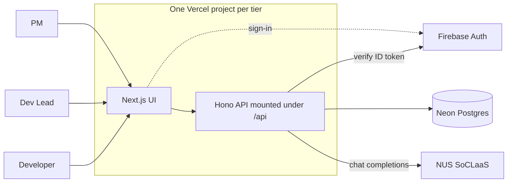
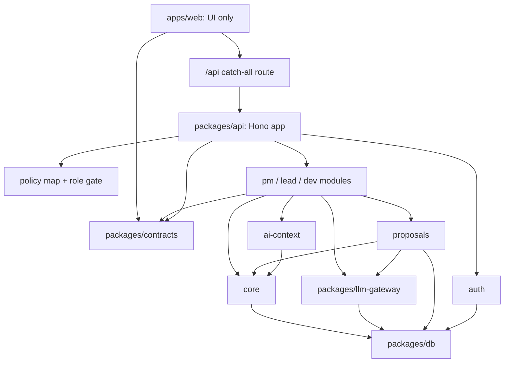
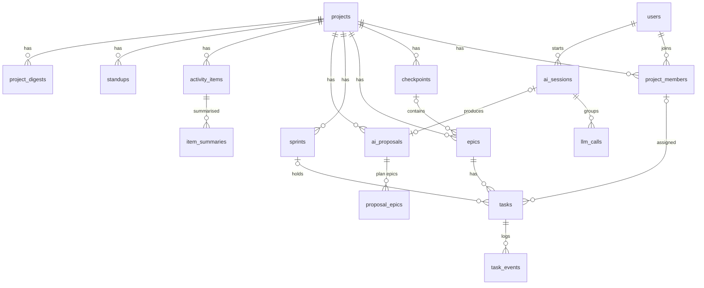
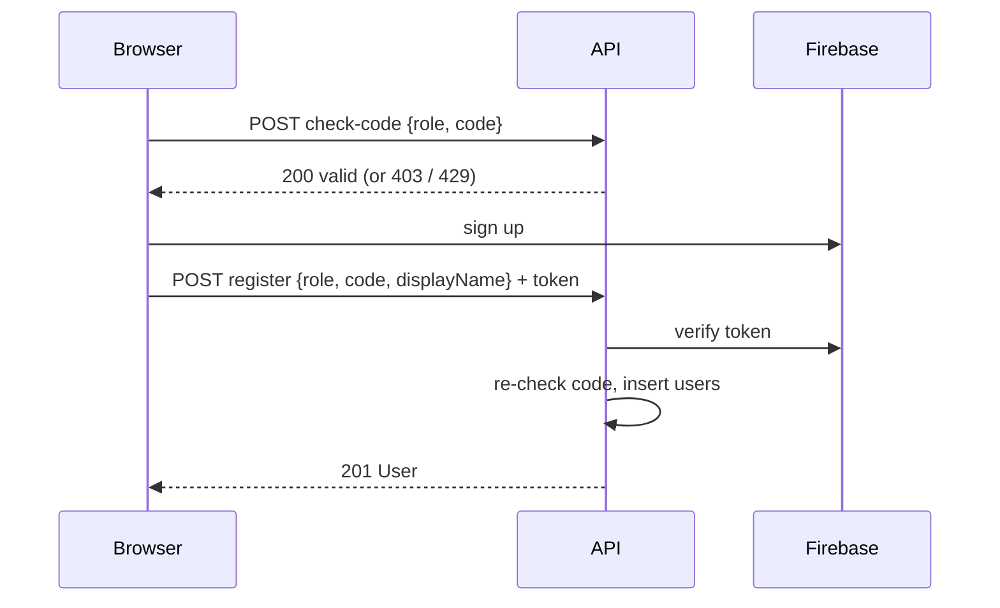
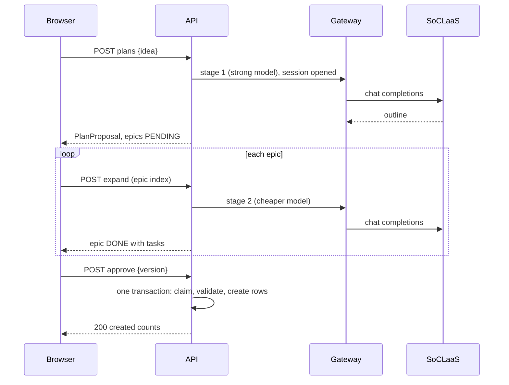

# Agile Platform Architecture (working title)

Status: Draft, second pass written (all sections have content) | Last audit: 2026-10-29, clean | Profiles: core, web-service, monolith-web | Readiness gate: **passed for the first implementation slice** (§16; deployment still needs G-33, G-26 and G-32)

How each decision was reached is in [decision-log.md](decision-log.md); field-level contracts are in [contracts.md](contracts.md) (§6). Decisions are cited as D-nn. **A-nn** marks a delegated assumption: an AI default written because the team asked for the findings in `concerns.md` to be integrated, awaiting the team's confirmation (§16). Nothing here rests on a Proposed item.

## Sign-off sheet (2026-10-29, second reply: settled except four)
The team adopted the three open items and approved the remaining assumptions except the ones below. Everything else is Decided in §15 (D-53 to D-63).

| Item | State |
|---|---|
| A-04 limiter | **Decided, D-59**: a fixed-window counter table replaces the row counting and the slots |
| A-05 uploads | **Decided, D-60**: no `author` field; items belong to the uploader |
| A-07 plan epics | **Decided, D-61**: `proposal_epics` rows |
| A-10 registration | **Decided, D-63**: codes of at least 13 characters, the demo codes for local and dev; email verification and disabling users stay out of scope (D-57) |
| A-17 development process | **Deferred**: to be woven together with the project's skills when the process files are written |
| A-12, A-13, A-16 | **Decided, D-64 to D-66** (A-16 narrowed: migrations and recovery go to the spec) |
| A-09 cache keys | **Decided, D-67** |

Given on 2026-10-29: the deadline is 13 November 2026 (G-01); Vercel is on the free Hobby plan; GitHub is on the education plan (G-29). Still unverified: reachability of SoCLaaS from Vercel (G-26).

## 1. Purpose and scope
- Owns: projects, epics, tasks, checkpoints and sprints for Agile scrum teams; role-specific LLM features; the LLM gateway; LLM usage metering.
- Does not own: source hosting and CI (GitHub); the LLM service (NUS SoCLaaS); identity credentials (Firebase Auth).
- Users and roles (Given: the brief and the team):
  - Project Manager (PM): comes up with ideas; AI helps draft the approach, epics, tasks and checkpoints, which are handed to Dev Leads.
  - Dev Lead: takes on several projects and keeps progress on track; AI helps adjust deadlines and checkpoints from progress.
  - Developer: owns the code; AI consolidates their work into a standup summary.
- Non-goals (consequences of the decisions): GitHub integration (the MVP takes an uploaded file, D-20); diffs as AI input (D-20); scheduled jobs (D-06); comments, attachments, subtasks, labels, priorities and custom workflows (D-09); per-project roles (D-07); email invitations (D-08); embeddings and vector search (D-28); per-pull-request databases (D-29); a restore feature for deleted rows (D-36, D-51); streaming responses; a client-controlled AI setting of any kind (A-07).

## 2. Requirements and traceability
| ID | Requirement | Component(s) | Contract / data affected | Verification evidence | Status |
|----|-------------|--------------|--------------------------|-----------------------|--------|
| R1 | At least one LLM-based AI feature per role | `pm`, `lead`, `dev` modules over `llm-gateway` (§4) | contracts.md §3.4 to 3.6; `ai_proposals`, `proposal_epics`, `project_digests`, `item_summaries`, `standups` | A demo per role; the guard corpus per feature (D-26) | Contracts written |
| R2 | Spec-Driven Development and Multi-Agent SE in the process | `.claude/agents/`, `docs/specs/`, hand-off notes (D-30) | specs, plans, branch-state notes | Hand-off files per stage; the task log (D-31); the OpenAPI contract test (A-17) | Design decided |
| R3 | Security of the AI features and of the development process | `llm-gateway/guard`, `ai-context`, the policy map (§4, §7); CI and repository settings (D-32, A-17) | threats T1 to T11 (decision log D-25); policy map in contracts.md | Four test layers plus attack success criteria (D-26, A-17); secret scan and branch protection (D-32) | Design decided |
| R4 | Deployed online; development and production separated | Vercel Preview and Production, separate Neon, Firebase and SoCLaaS resources (D-29, A-11) | environment variables per tier | Two live URLs; a startup assertion that tier, Firebase project, database host and `env` match | Design decided; checks open (G-26, G-27, G-29, G-32) |
| R5 | Context engineering and resource-aware use, in the app and the process | `llm-gateway/metering` (`llm_calls`, `ai_sessions`), section budgets, caches (D-15 to D-19, D-24) | `llm_calls`, `ai_sessions`, contracts.md §3.7 | Usage page; experiments (G-23); telemetry CSV (D-31) | Contracts written; experiments open |
| R6 | Simple UI; shared components designed with SRP and DRY | `packages/contracts`, `packages/db`, module boundaries (§4) | one schema, one error shape, one policy map | Import-rule tests (D-01b, D-25, A-03) | Design decided; UI plan in §13 |
| R7 | Reflection document | `docs/reflection.md` | none | the document | Not started |

## 3. Context and dependencies


| Dependency | Purpose | Interface owner | Contract status | Impact if it fails |
|------------|---------|-----------------|-----------------|--------------------|
| NUS SoCLaaS (OpenAI-compatible; Given, the only provider) | all role AI features | NUS SoC | existing: `/v1/chat/completions` and `/v1/models`; `usage` reports only prompt, completion and total tokens (§12); reachability from Vercel unverified (G-26), mocked until confirmed | AI features follow D-34 (PM error, Dev Lead facts only, Developer code-built standup); the rest works |
| Firebase Auth (one project per tier) | sign-in and ID tokens | Google | existing (used in MP3) | no one can sign in; stored data is safe |
| Neon Postgres (one project per tier) | all data, limiter state | Neon | existing (used in MP3) | the app is down |
| Vercel (one project, Preview and Production) | hosting, build, environment variables | Vercel | existing; plan limits unverified (G-29) | the app is down |
| GitHub | repository, CI, branch protection | GitHub | existing; branch protection on a private repository may need a paid plan (G-29) | no deploys; the running app is unaffected |

## 4. Components and responsibility boundaries
One repository, one deployable per tier (D-01a). Dependency direction runs downward. A module reaches another module only through that module's **exported functions**; it never imports its tables or its Prisma models (A-03).



| Component | Owns (data and behaviour) | Must not own | Work package |
|---|---|---|---|
| `apps/web` | pages, components, the contracts client, role-based navigation | any database or Prisma import (tested, D-01b); business rules; role checks as a security control | per role owner |
| `packages/contracts` | zod schemas, error codes, OpenAPI generation, the **policy map** (allowed roles and ownership predicate per operation), the upload and proposal payload schemas | logic with side effects | E |
| `packages/db` | Prisma schema and migrations, the client with a default extension that excludes soft-deleted rows and archived projects (opt-out must be explicit, A-13) | business rules | E |
| `packages/api` (Hono app) | route registration; middleware: request id, token check, user lookup (registered), the policy-map gate, error mapping | domain logic in route handlers | E |
| `auth` | `users`, `rate_counters` (with the exported `hit(key, windowSeconds, limit)` used by the gateway and the registration routes); token verification; registration and codes; the membership helper `requireMember` | project data | A |
| `core` | `projects`, `project_members`, `checkpoints`, `epics`, `sprints`, `tasks`, `task_events`; progress and velocity functions; `assertWritable`; `applyPlan` and `applyReplan` (called by `proposals` with a transaction handle) | AI calls; prompts | B |
| `proposals` | `ai_proposals`, `proposal_epics`; payload validation; the claim-and-apply protocol (A-06) | writing domain tables directly | B |
| `ai-context` | the one context-assembly function (contracts.md §5.2) | prompts; model calls | J (signature frozen first) |
| `pm` | PM routes, plan prompts and sections (D-21), similar-item search (D-28) | other roles' tables | G |
| `lead` | Dev Lead routes, the pure forecast functions, digest and re-plan prompts (D-22), `project_digests` | task writes except through `proposals` and `core` | H |
| `dev` | upload routes, `activity_items`, `item_summaries`, `standups`, summary and standup prompts (D-38, D-27) | project or task writes | I |
| `llm-gateway` | guards (D-25), limiter (D-16, D-59), SoCLaaS client, model capability records and prices (D-23a, D-24), mock mode, `llm_calls`, `ai_sessions`, `llm_gateway_state`; exported functions for sessions and for usage queries | feature prompts; project or user tables | C (guards), D (runtime), F (usage routes and page) |

Boundary answers:
- **Transactions** start in the service of the module that owns the tables. The proposal apply is one transaction (D-10, A-06). No model call runs inside a database transaction.
- **Authorization** is enforced by the policy-map gate for every route (role, plus an ownership predicate where the map names one), `requireMember` inside `core` for project-scoped data, and the gateway's check that the caller's role may run the feature. A route handler never checks roles itself. The UI hides actions as a convenience only. CI fails if a route is missing from the map (A-01).
- **Derived values** (progress, velocity, projected completion, checkpoints at risk, overload) are computed in pure functions in `core` (progress and velocity) and `lead` (forecast). The LLM never computes them (D-12, D-22).
- **Table ownership**: one owner per table (the column above). No module queries another module's tables.
- **Module dependency rules** are enforced by a source-scan test in CI (D-01b, D-25) plus the runtime membership checks inside `ai-context`; the scan alone is not relied on. Role modules (`pm`, `lead`, `dev`) do not import each other.
- **Frozen first** (A-18): `packages/contracts` with the policy map, `LlmGateway.run` with its mock mode, `AiContext.assemble`, and `Sessions`, all specified in contracts.md §5, before the role slices start.

## 5. Data model
Identifiers are UUIDs unless stated. Timestamps are `timestamptz` in UTC; calendar dates are `date` values read in the application time zone (D-37). `version` is an integer starting at 1 on every mutable entity listed (D-35).



### Domain tables (owned by `auth` and `core`)
| Table | Fields (type, null) | Keys, uniqueness, indexes | Notes |
|---|---|---|---|
| `users` | id; firebase_uid text not null; email text not null; display_name text not null; role enum `PM`/`DEV_LEAD`/`DEVELOPER` not null; created_at | PK id; unique firebase_uid; unique email | One role per account (D-07). The role is ours, never read from the token. Disabling an account is done in Firebase (D-57). |
| `projects` | id; name text(200) not null; brief text(4000) null; status enum `ACTIVE`/`ARCHIVED`; created_by → users; created_at; updated_at; version | PK id; index (status) | Archived is read-only; one `assertWritable` check covers every write path including AI writes (A-13). |
| `project_members` | project_id → projects; user_id → users; added_by → users; added_at | PK (project_id, user_id); index (user_id) | No role column: the user's global role applies (D-07). |
| `checkpoints` | id; project_id; name text(200); target_date date not null; created_at; updated_at; version; deleted_at null | PK id; **unique (project_id, id)**; index (project_id, target_date) where deleted_at is null | Soft delete (D-36). |
| `epics` | id; project_id; checkpoint_id null; title text(200); description text(4000) null; position int; created_at; updated_at; version; deleted_at null | PK id; **unique (project_id, id)**; **FK (project_id, checkpoint_id) → checkpoints (project_id, id)**; indexes (project_id), (checkpoint_id) | At most one checkpoint (D-14). Deleting soft-deletes its tasks and clears checkpoint_id. |
| `sprints` | id; project_id; name text(200); start_date date; end_date date; status enum `PLANNED`/`ACTIVE`/`CLOSED`; completed_points int null; created_at; updated_at; version; deleted_at null | PK id; **unique (project_id, id)**; index (project_id, start_date) | `completed_points` is stored when a sprint closes, from its DONE tasks (D-12). Dates inclusive, no overlap, one ACTIVE sprint per project (D-45). Only a PLANNED sprint may be deleted (D-49). |
| `tasks` | id; project_id not null; epic_id not null; sprint_id null; assignee_id null; title text(200); description text(4000) null; acceptance_criteria jsonb (list) default []; status enum `TODO`/`IN_PROGRESS`/`IN_REVIEW`/`DONE`; blocked boolean default false; blocked_reason text(500) null; story_points smallint null; done_at null; created_by; created_at; updated_at; version; deleted_at null | PK id; **FKs (project_id, epic_id) → epics; (project_id, sprint_id) → sprints; (project_id, assignee_id) → project_members**; indexes (project_id, status), (assignee_id), (epic_id), (sprint_id) | The composite keys make a cross-project reference impossible and an assignee a member (A-02). `story_points` ∈ {1,2,3,5,8,13}, required when sprint_id is set (D-12). `blocked_reason` required when blocked (D-13). `done_at` set on entering DONE, cleared on leaving it. A DONE task cannot be deleted (D-36). A task in a CLOSED sprint cannot change points, sprint or status (A-14). |
| `task_events` | id bigserial; task_id; project_id; actor_id → users; type enum (see contracts.md); from_value null; to_value null; at | PK id; indexes (project_id, at), (task_id, at) | Append-only, written in the same transaction as the change. Feeds standups and velocity. |

### AI and platform tables
| Table (owner) | Fields | Keys, uniqueness, indexes | Notes |
|---|---|---|---|
| `ai_proposals` (`proposals`) | id; project_id; kind `PLAN`/`REPLAN`; status `PENDING`/`APPROVED`/`REJECTED`/`SUPERSEDED`; payload jsonb not null (PLAN: approach, checkpoints, retrieved-item provenance; REPLAN: explanation and suggestions); session_id → ai_sessions; created_by; applied_by null; applied_at null; flagged boolean; created_at; updated_at; version | PK id; indexes (project_id, status), (session_id) | Approval applies the payload in one transaction (D-10, A-06). A PLAN is approvable only when every epic row is DONE (D-46). |
| `proposal_epics` (`proposals`) | proposal_id; index int; title; description; checkpoint_name null; content_hash text; expansion_status `PENDING`/`IN_PROGRESS`/`DONE`/`FAILED`; lease_expires_at null; tasks jsonb null; error text null; version; updated_at | PK (proposal_id, index) | One row per plan epic so parallel expansions do not overwrite each other (A-07). `IN_PROGRESS` carries a lease; a row whose lease has passed is read as PENDING. |
| `ai_sessions` (`llm-gateway`) | id; feature; user_id; project_id null; env; started_at; last_activity_at; ended_at null; outcome `OPEN`/`ACCEPTED`/`EDITED`/`REJECTED`/`ABANDONED`; regenerate_count int default 0; feedback `UP`/`DOWN` null | PK id; indexes (user_id, started_at), (feature, started_at) | Server-issued only; ownership, feature and OPEN state checked on every use (D-19, A-07). An inactive OPEN session becomes ABANDONED when next read. |
| `llm_calls` (`llm-gateway`) | id; created_at; session_id null (null only for evaluation runs); user_id; role; project_id null; env; feature; model; prompt_version; status `IN_FLIGHT`/`OK`/`SCHEMA_FAIL`/`UPSTREAM_ERROR`/`TIMEOUT`/`REFUSED`/`BLOCKED_INPUT`/`RATE_LIMITED`/`BUDGET_BLOCKED`/`CACHE_HIT`; lease_expires_at null; prompt_tokens, completion_tokens, total_tokens int null; attempts smallint; latency_ms int null; estimated_prompt_tokens int; section_tokens jsonb; prefix_hash; input_hash; flagged; truncated; cost_microusd bigint null; experiment jsonb (the server-side settings in force) | PK id; indexes (created_at), (user_id, created_at), (feature, created_at), (session_id), (lease_expires_at) where status = IN_FLIGHT | The row is written when the call is admitted, as `IN_FLIGHT` with a lease, and finalised afterwards; an expired lease is finalised as `TIMEOUT` when next read. The lease is bookkeeping only; limits come from `rate_counters` (D-59). Never stores prompt text, response text or the key. |
| `llm_gateway_state` (`llm-gateway`) | key; value jsonb; updated_at | PK key | Circuit breaker and budget-block state (D-05, A-12). |
| `rate_counters` (`auth`) | key text; window_start timestamptz; count int | PK key | Fixed-window counters (D-59). One atomic upsert per admission, by the database clock: if the window has elapsed, `window_start` = now and `count` = 1, otherwise `count` + 1. Keys: `global:min`, `global:day`, `user:<id>:min`, `user:<id>:day` for AI calls; an HMAC of the client IP plus the purpose for `check-code` and `register`. The raw IP is never stored. |
| `activity_items` (`dev`) | id; project_id; uploaded_by → users; item_type `COMMIT`/`PR`; repo text(200) not null default ''; external_id text; title text(300); body text(2000) null; body_truncated; occurred_at; url text null (`https:` only); files jsonb; content_hash; flagged; created_at; updated_at | PK id; **unique (project_id, uploaded_by, item_type, repo, external_id)**; index (project_id, uploaded_by, occurred_at) | Items belong to the uploader, who is the signed-in user; the upload has no author field (D-60). A re-upload with a changed hash updates the row and invalidates its summary. |
| `item_summaries` (`dev`) | id; item_id → activity_items; content_hash; guard_version; prompt_version; one_liner text(300); flagged; call_id → llm_calls; created_at | PK id; unique (item_id, content_hash, guard_version, prompt_version) | The per-item summary cache (D-18). A new guard version means a fresh summary (A-09). |
| `standups` (`dev`) | id; project_id; developer_id → users; standup_date date; content jsonb; input_hash; degraded; flagged; outcome null; feedback null; session_id; created_at; updated_at; version | PK id; unique (project_id, developer_id, standup_date) | One per developer, project and day (D-27). Regenerating replaces the content. |
| `project_digests` (`lead`) | id; project_id; facts jsonb; facts_hash; explanation null; degraded; flagged; proposal_id null; session_id null; created_at | PK id; index (project_id, created_at) | The latest row is the "previous digest" for the next run (D-22). |

### Stored, derived and server-managed
- **Derived, never stored**: progress, velocity of an open sprint, projected completion, checkpoint risk, overload. They are recomputed from tasks, sprints and events; a copy lives inside `project_digests.facts` as a snapshot.
- **Stored on purpose**: `sprints.completed_points` (frozen at close); standup, summary and digest text (cache of AI output).
- **Server-managed** (a request that includes them gets 422): id, project_id on tasks, created_*, updated_at, version, done_at, deleted_at, proposal and session fields, call fields.
- **Seed and reference data**: for local and dev, one demo user per role and one demo project with history for forecasts and retrieval (D-28). Registration codes live in environment variables, not the database (D-08). Model prices come from configuration or `/v1/models` (D-24).

### Lifecycle and delete behaviour
| Entity | States | Delete |
|---|---|---|
| Project | ACTIVE → ARCHIVED | archived, never deleted (D-36) |
| Epic, task, checkpoint | live → soft-deleted | soft; a DONE task cannot be deleted; an epic delete cascades to its tasks and unlinks the checkpoint |
| Sprint | PLANNED → ACTIVE → CLOSED | PLANNED only, soft (D-49) |
| Proposal | PENDING → APPROVED / REJECTED / SUPERSEDED | never deleted |
| Session | OPEN → ACCEPTED / EDITED / REJECTED / ABANDONED | never deleted |
| `llm_calls`, `task_events` | append-only | no automatic retention in the MVP (D-42) |

Migrations: decided in the spec (G-28, D-66).

## 6. Interfaces and contracts
The field-level contracts are in [contracts.md](contracts.md): conventions, shared schemas, 57 endpoints with caller policy, request, response, errors and side effects, examples, and the four frozen-first module interfaces (`LlmGateway.run`, `AiContext.assemble`, `Sessions`, `Core`). The caller-policy column is the policy map that `packages/contracts` implements (A-01).

## 7. Identity, permissions and trust boundaries
**Authentication (D-03).** The browser signs in with Firebase and sends `Authorization: Bearer <ID token>`. The API verifies the token on every request against Google's public keys: algorithm RS256, issuer and audience from the tier's Firebase project id (library chosen in the spec). Claims used: `sub` and `email`. The application role comes from `users`, never from a claim or the client. After verification the middleware loads the `users` row before the policy gate. Email verification and account disabling are Firebase configuration (D-57): a token that passes verification belongs to a verified, enabled account, so the application keeps no verified or disabled state and has no `EMAIL_NOT_VERIFIED` or `USER_DISABLED` path. This assumes the Firebase project is configured to issue tokens only to such accounts.

**Registration (D-08, D-63).** Codes are strings of at least 13 characters, one per role per tier (local and dev use the demo codes of D-63; production codes are different, random and secret), compared in constant time and never logged (request bodies of these two endpoints are not logged). `POST /api/auth/check-code` is public and rate-limited per client IP; `register` checks the code again as the final authority, and is also rate-limited. The client IP is taken from the header the hosting platform sets (not one the client can supply; the spec names it); only an HMAC of it is stored. A Firebase account created directly, without a `users` row, can call nothing except `register` and gets 403 `USER_NOT_REGISTERED`.

**Authorization (D-07, A-01).** Every operation has one entry in the policy map: allowed roles plus an ownership predicate (`member`, `self`, `assignee`, `adder`). The gate runs after authentication. A wrong role gets 403; a project the caller is not a member of, or a resource outside it, gets 404 (D-33). Summary of the map (full per-endpoint column in contracts.md §3):

| Operation group | PM | Dev Lead | Developer | Basis |
|---|---|---|---|---|
| Register, check code, `me` | all | all | all | D-08 |
| Create a project; edit or archive it | yes (member) | no | no | D-47 |
| Add or remove members | Dev Leads | developers | no | D-39 |
| Read project, epics, tasks, sprints, checkpoints, progress | member | member | member | D-07 |
| Create, edit or delete epics, checkpoints and tasks | yes | yes | no | D-47 |
| Change a task's status and blocked flag | no | yes | own assigned tasks | D-47 |
| Create, start, close, delete sprints | no | yes | no | D-47 |
| Generate, edit, approve or reject a PLAN | yes | no | no | D-10, D-21 |
| Facts, digest, request and approve a REPLAN | no | yes | no | D-10, D-22 |
| Upload activity; summarise; generate or edit own standup | no | no | yes | D-20, D-27 |
| Read a standup | no | their projects' developers | own only | D-27 |
| Usage: own sessions; platform aggregates without per-user content | yes | yes | yes | D-47 |

**Object-level rules.** A standup is readable by its developer and by a Dev Lead who is a member of the same project; an activity item and its summaries only by the uploader (and through the standup built from them). Every id in a path is resolved inside the caller's member projects before use, so changing an id cannot reach another object (C-01).

**Browser security (A-15).** The UI and API share one origin, so any script injection reaches the whole API. Controls: a Content Security Policy that forbids inline script and third-party origins other than Firebase; `frame-ancestors 'none'`; AI and uploaded text rendered as plain text; `url` fields accepted only as `https:` and rendered with `rel="noopener noreferrer"`; the Firebase SDK's default token storage; no cookie authentication, so there is no CSRF surface; the generated OpenAPI document and any Swagger UI are not served in production.

**Trust boundaries.**
| Input | Source | Treated as | Validated where |
|---|---|---|---|
| Request body, query, path | any client | untrusted | zod schema from `packages/contracts`; unknown fields rejected |
| Firebase ID token | client | untrusted until verified | auth middleware |
| PM idea; task titles and descriptions; retrieved item titles | users | untrusted text when sent to a model | gateway pipeline (D-25) |
| Uploaded activity file | Developer | untrusted file and text | size, item limits and schema (D-38), then the pipeline; `flagged` stored on the item, summary and standup |
| Model output, including a stored summary reused as input | SoCLaaS | untrusted | output validator, schema, plain-text rendering; reused output is wrapped as untrusted data again |
| Registration codes | client | secret comparison | `auth`, constant time, rate-limited |
| Environment settings | operator | trusted | startup assertions (A-11) |

**Pipeline additions (A-12 and the review, in addition to D-25).** Delimiter-tag removal repeats until the text no longer changes; each call wraps untrusted text in a random per-call boundary and checks the boundary is absent from the content; truncation happens before wrapping and never cuts the security suffix; output validation also rejects bidirectional and zero-width characters after NFKC normalisation. A flagged input is still sent to the model (marked, not blocked), because the safeguards are the closed output formats and the human approval steps.

**Security verification (D-26, A-17).** Each corpus case has a machine-checkable success criterion: a canary string must not appear in output, a forbidden project id must not appear in a context or suggestion, a link must not survive validation, a cross-project object must return 404. The corpus and the generated authorisation tests are reviewed by a different owner than the one who wrote the guards.

## 8. Errors
**Shape (D-33).** One envelope for every error; `X-Request-Id` is also a header and is logged with the status and code, never with credentials, tokens, codes or prompts.

```json
{
  "error": {
    "code": "VALIDATION_FAILED",
    "message": "The request body is not valid.",
    "details": [{ "field": "storyPoints", "message": "Must be one of 1, 2, 3, 5, 8, 13." }],
    "requestId": "7d1c2f0e-4b7a-4f6b-9d36-0f2f8a2d5c11"
  }
}
```

**Mapping.** Rows tagged D-nn follow a decision; rows tagged A-nn are delegated assumptions.

| Condition | Operation(s) | Status and code | Basis |
|---|---|---|---|
| Malformed JSON or wrong content type | any with a body | 400 `BAD_REQUEST` | D-33 |
| Schema failure: unknown or server-managed field; points outside the set; `blocked` without a reason; sprint end before start or overlapping; `sprintId` set without points; assignee not a member; empty input after sanitising; more than 100 items in an upload; an item `url` that is not `https:` | any | 422 `VALIDATION_FAILED` with `details` | D-33, D-12, D-13, D-38, A-05 |
| The model declined the request as out of scope (`{"refusal":true}`) | PM endpoints | 422 `REQUEST_REFUSED` | A-12 |
| No Authorization header, expired or invalid token | all except health and `check-code` | 401 `UNAUTHENTICATED` | D-33 |
| Valid token, no `users` row | all except `register` | 403 `USER_NOT_REGISTERED` | D-50 |
| Invalid registration code | `register`, `check-code` | 403 `REGISTRATION_CODE_INVALID` | D-50 |
| Registering twice (same uid or email) | `register` | 409 `ALREADY_REGISTERED` | A-12 |
| Wrong role for the operation | role operations | 403 `FORBIDDEN_ROLE` | D-07, D-33 |
| Missing, soft-deleted, or outside the caller's projects | any project-scoped | 404 `NOT_FOUND` | D-33, D-36 |
| Update sent with a stale `version` | updates | 409 `CONFLICT_VERSION` | D-35 |
| Invalid state: delete a DONE task or an epic holding one; change a task in a CLOSED sprint; write to an archived project; start a sprint that is not PLANNED or while another is ACTIVE; remove a member with open assigned tasks; approve a REJECTED or SUPERSEDED proposal; approve a PLAN with an epic not DONE; approve a REPLAN suggestion that no longer fits the project | those operations | 409 `CONFLICT_STATE` | D-36, D-10, D-46, A-14 |
| Approve an already APPROVED proposal; re-upload an item; add an existing member | approve, upload, add member | 200 with the same result, not an error | D-35 |
| Upload larger than 1 MB | upload | 413 `PAYLOAD_TOO_LARGE` | D-38 |
| Window limit (per user or global), daily cap or spend cap | AI endpoints | 429 `AI_BUSY` with `Retry-After`; `details.reason` is `LOCAL_LIMIT` | D-16, D-34, D-59 |
| Upstream rate limit (SoCLaaS 429) after backoff | AI endpoints | PM: 503 `AI_UNAVAILABLE`; others: degraded 200; `details.reason` is `UPSTREAM_LIMIT` | D-34, A-12 |
| Code-check or register rate limit; per-session regeneration cap; per-user session caps | `check-code`, `register`; regenerate; session start | 429 `RATE_LIMITED` with `Retry-After` | D-25, D-41, A-07 |
| Upstream failure, timeout, open breaker, exhausted budget or invalid model output | PM endpoints | 503 `AI_UNAVAILABLE` | D-34 |
| AI disabled in this environment (unreachable or switched off) | AI endpoints | PM: 503 `AI_DISABLED`; others: degraded 200 | D-66 |
| The same failures | Dev Lead and Developer endpoints | 200 with `degraded: true` and the code-built content | D-34 |
| Injection flag raised | AI endpoints | 200 with `flagged: true`, not an error | D-25 |
| Unexpected failure | any | 500 `INTERNAL`, only the `requestId` | D-33 |

## 9. Workflows: normal and failure
Each failure matrix uses the columns: step, sync or async, in a transaction, idempotent, if it fails, what the user sees, retry or compensation. All steps are synchronous requests; there is no queue (D-06).

### 9.1 Registration

| Step | Sync | Transaction | Idempotent | If it fails | User sees | Retry or compensation |
|---|---|---|---|---|---|---|
| check-code | sync | no | yes | wrong code 403; limit 429 | "code not accepted" or "wait a minute" | retry after `Retry-After` |
| Firebase signup and email verification | sync (external) | n/a | n/a | Firebase error | Firebase message | retry; an account without a `users` row is harmless |
| register | sync | yes (one insert) | repeat gives 409 `ALREADY_REGISTERED` | code or race | the matching error | retry |

### 9.2 PM plan generation and approval

| Step | Sync | Transaction | Idempotent | If it fails | User sees | Retry or compensation |
|---|---|---|---|---|---|---|
| Open session, stage 1 | sync | no (the model call is outside any transaction) | no, a repeat is a new session | busy, unavailable, disabled or refused | error with a "create manually" path | retry later; an unused session becomes ABANDONED |
| Store proposal and epic rows | sync | yes | yes | rollback; the model result is lost | 500 or error; tokens were spent | retry |
| Expand one epic | sync | claim is one short transaction; the model call is outside | yes by state: DONE returns the stored result | that epic becomes FAILED (or stays PENDING if the function died) | that epic shows "retry"; other epics unaffected | retry the epic; an expired lease reads as PENDING |
| Edit an epic | sync | yes | yes | stale version 409 | "someone else changed this" | reload |
| Regenerate an epic | sync | as expand | no, counts toward the cap | cap reached: 429 | "regeneration limit reached" | edit by hand |
| Approve | sync | **one transaction** (row lock claims the proposal) | yes: a second request waits on the lock and then sees APPROVED | any invalid id, assignee not a member, archived project, epic not DONE: 409, nothing created | the reason | fix and retry |

### 9.3 Dev Lead analysis and re-plan
| Step | Sync | Transaction | Idempotent | If it fails | User sees | Retry or compensation |
|---|---|---|---|---|---|---|
| Compute facts (code) | sync | read only | yes | database error 500 | error | retry |
| Digest: hash unchanged | sync | no | yes | not applicable | the cached digest | none |
| Digest: model call | sync | model call outside a transaction | no, a changed hash creates a new digest | upstream, busy or invalid output | facts with `explanation: null`, `degraded: true` | retry later |
| Store digest and REPLAN proposal | sync | yes | yes | rollback | error | retry |
| Approve chosen suggestions | sync | one transaction; every id re-checked against the project, assignee membership and the actor's role | yes by state | a suggestion no longer fits: 409 listing it, nothing applied | "this suggestion is out of date" | regenerate the digest |

### 9.4 Upload, summaries and standup
| Step | Sync | Transaction | Idempotent | If it fails | User sees | Retry or compensation |
|---|---|---|---|---|---|---|
| Upload | sync | yes (all items or none) | yes: same keys and hashes give "unchanged" | too large 413; invalid items listed in `rejected` | counts and rejected items | fix the file and re-upload |
| Summary batch (up to 10 uncached items in the window) | sync | model call outside; inserts in one short transaction | yes: cached items skipped | the batch fails | those items remain without a summary | the browser re-sends the batch |
| Standup generation | sync | as above | yes: same input hash returns the stored standup | model fails | a code-built standup marked degraded | regenerate later |
| Edit standup | sync | yes | version check | stale 409 | reload | retry |

### 9.5 Sprint close
| Step | Sync | Transaction | Idempotent | If it fails | User sees | Retry or compensation |
|---|---|---|---|---|---|---|
| Close with carry-over choices | sync | one transaction: set `completed_points`, move carried tasks, write events, mark CLOSED | a repeat gets 409 (already CLOSED) | any task not DONE without a carry-over entry: 422; rollback on error | the missing tasks | resend with all entries |

## 10. Asynchronous processing
There is no queue, no scheduler and no background worker (D-06). AI work is request-driven; each stage-2 expansion and each summary batch is its own browser request (D-21, D-38). The only time-based state is the lease on an `IN_FLIGHT` call and on an `IN_PROGRESS` epic.

| Operation | Producer | Consumer | Idempotency key | Retry | Dead letter |
|---|---|---|---|---|---|
| Epic expansion | browser | `pm` via the gateway | (proposal, epic index, epic content hash, prompt version) | the browser may retry; a DONE epic returns its stored result | none; a FAILED epic is retried by the user |
| Summary batch | browser | `dev` via the gateway | (item id, content hash, guard version, prompt version) per item | the browser retries the batch; cached items are skipped | items stay unsummarised |
| Digest | Dev Lead click | `lead` via the gateway | facts hash | by the user | none |
| Standup | Developer click | `dev` via the gateway | input hash and date | by the user | code-built fallback |

Answers to the three questions:
- **The store commits but a follow-up never happens**: there is no enqueue. A stage-1 result is stored in one transaction with its epic rows, so a proposal never exists without its epics.
- **A request is delivered twice** (browser retry, double click): safe by state and by the keys above (D-35); the apply is serialised by a row lock.
- **A step succeeds but its success is never recorded** (the model answered but the function died before storing): the `llm_calls` row stays `IN_FLIGHT` until its lease expires and is then finalised as `TIMEOUT`; the window counter already counted it; the user retries and pays again. This is accepted.
- The client timeout to SoCLaaS is set below the function's `maxDuration`, so a call is normally finalised by its own request (D-59).

## 11. State, time and derived values
**Task.** Statuses `TODO`, `IN_PROGRESS`, `IN_REVIEW`, `DONE`; any move between statuses is allowed (a reopen from DONE clears `done_at`); `blocked` is independent. A task in a CLOSED sprint is frozen (A-14).
| Event | From | To | Side effects |
|---|---|---|---|
| status change | any status | any other | `STATUS_CHANGED` event; `done_at` set on entering DONE, cleared on leaving |
| block / unblock | blocked false / true | true / false | `BLOCKED` or `UNBLOCKED` event; a reason is required to block |
| assign | any | another member or none | `ASSIGNEE_CHANGED` event |
| sprint assignment | any | a PLANNED or ACTIVE sprint | requires story points; `SPRINT_CHANGED` event |

**Sprint.**
| Event | From | To | Side effects |
|---|---|---|---|
| start | PLANNED | ACTIVE | at most one ACTIVE sprint per project |
| close | ACTIVE | CLOSED | `completed_points` = sum of story points of its DONE tasks; every not-DONE task is carried to the backlog or a PLANNED sprint |
| delete | PLANNED | removed (soft) | its tasks go to the backlog |

**Proposal.** `PENDING` → `APPROVED` (apply succeeded), `REJECTED` (user), `SUPERSEDED` (a newer proposal of the same kind for the same project was created while this was PENDING, or the project was archived). Terminal states do not change. **Plan epic**: `PENDING` → `IN_PROGRESS` (leased) → `DONE` or `FAILED`; an expired lease reads as PENDING; an edit of title or description resets it to PENDING; `FAILED` can be retried. **Session**: `OPEN` → `ACCEPTED` / `EDITED` (approval or standup accept or edit) / `REJECTED` / `ABANDONED` (no activity for 24 hours, set when next read).

**Time.** Instants are UTC; "days" use `Asia/Singapore` (D-37). Sprint start and end dates are inclusive calendar dates (D-45). The standup window runs from 00:00 of the previous working day (Monday to Friday, holidays ignored) to now (D-44). The SoCLaaS budget day and the limiter's day counts use UTC. A task `timestamp` in an upload may not be more than 24 hours in the future (A-05).

**Derived values (computed in code, D-12, D-22; formulas are A-19).**
- `pointsTotal` = story points of live tasks that have points; tasks without points are counted separately as `unestimatedTasks`. `pointsDone` = those with status DONE. Progress percent = `pointsDone / pointsTotal`, 0 when the total is 0.
- Velocity of a closed sprint = its `completed_points`. `avgVelocity` = the mean over the last N = 3 closed sprints, or fewer if fewer exist (D-40); null when there are none.
- `pointsRemaining` = points of not-DONE live tasks. Sprints needed = `ceil(pointsRemaining / avgVelocity)`; `projectedCompletionDate` = the end of that many further sprints of the average closed-sprint length counted from today; null when `avgVelocity` is null.
- A checkpoint's `remainingPoints` = points of not-DONE tasks in its live epics. Its `projectedDate` is computed the same way. `risk` = `AT_RISK` if `projectedDate` is after `targetDate`, `ON_TRACK` if not, `UNKNOWN` when there is no velocity (D-40).
- Overload: a person with open assigned points in two or more of the caller's member projects whose total exceeds their average completed points per sprint over the last N sprints in those projects; `UNKNOWN` without history. Computed only over the caller's own projects (A-08).

## 12. External providers behind interfaces
**Interface.** All model calls go through `LlmGateway.run` (contracts.md §5.1). Stored per call: the `llm_calls` row (no prompt or response text). Returned to consumers: the validated value or an error code. The key is held by the backend only and never enters a prompt; the browser never calls SoCLaaS.

**Provider failure behaviour (D-16, D-34, A-12).** The circuit breaker counts only upstream failures (5xx, timeout, network), never user-attributable outcomes such as `SCHEMA_FAIL` or `BLOCKED_INPUT`. A SoCLaaS 429 is treated as transient: backoff, then `AI_UNAVAILABLE` or a degraded result, with `details.reason` `UPSTREAM_LIMIT`. A budget block comes only from the application's own cost estimate or the budget endpoint, and it decays: one probe after 15 minutes. If the gateway is unreachable from the hosted environment, the environment sets `AI_ENABLED=false`; AI endpoints then return `AI_DISABLED` or the degraded result, and everything else works (A-16). There is no cleanup of provider state.

**Model capability record** (configuration or a table, spec choice): `{ model, contextTokens, accepts: { reasoningEffort: [values], responseFormat: boolean }, tokenRatio, priceInMicroUsdPerMTok, priceOutMicroUsdPerMTok }` (D-23a, D-17, D-24).

Observed facts about SoCLaaS (Given, source: probe run by the team on 2026-10-28, `tools/probe-soclaas/probe.mjs`; each figure is one sample, so latencies are indicative only):
- `GET /models` returned 200 and listed 19 models; `llama3.1:8b`, `qwen3.5:9b` and `gemma4:26b` are all available.
- `usage` contains exactly `prompt_tokens`, `completion_tokens` and `total_tokens`, for all three models, with and without `reasoning_effort: none`. There are no cache or reasoning fields.
- The same prompt of about 5,000 tokens sent twice gave identical `prompt_tokens` and no consistent latency drop. Missing fields mean provider-side caching cannot be observed; they do not prove none happens.
- Token counts are tokenizer-specific: the same text counted 4,725 tokens on `llama3.1:8b` and about 5,115 on `qwen3.5:9b` and `gemma4:26b`.
- Latency for a prompt of about 5,000 tokens with at most 40 output tokens: `llama3.1:8b` 2.7 to 4.3 s, `qwen3.5:9b` 3.2 to 3.5 s, `gemma4:26b` 8.9 to 15.5 s.
- With `max_tokens` 40, some `qwen3.5:9b` and `gemma4:26b` calls ended with `finish_reason` `length`, so an output-token comparison of reasoning on versus off needs a larger limit.

Facts from the SoCLaaS integration guide (Given, with a caveat: the guide is an assistant's summary of SoC DocHub read on 2026-10-21, supplied by the team; verify against DocHub before relying on any figure):
- Base URL `https://soclaas-api.comp.nus.edu.sg/v1`; Bearer key; the key is the unit of limiting, shared by every use of that key (the app, coding assistants, Open WebUI).
- Default limits: 90 requests per minute, 80,000,000 µ$ per day ($80) and 800,000,000 µ$ per month ($800). Day and month are UTC. The limits "will be adjusted from time to time". The cost is a rate-control unit, not money.
- Prices are µ$ per million tokens (input / output), and `GET /v1/models` is the authoritative cost basis. The guide's table lists: `llama3.1:8b` 20,000 / 30,000 (context 65,536); `qwen3.5:9b` 100,000 / 150,000 (65,536); `gemma4:26b` 60,000 / 300,000 (131,072); `qwen3-coder-next` 110,000 / 800,000 (196,608; coding agents); `qwen3.6:35b` 140,000 / 900,000 (262,144; agentic and tool calling); `qwen3.8:27b` 195,000 / 900,000 (262,144; reasoning); `qwen3-vl:32b` (vision, 80,000); `ornith:35b` 260,000 / 900,000 (262,144; software-engineering agents; the guide also spells it `ornith1.5:35b`, so confirm the id from `/v1/models`). A test model `x-test-1` appeared on 2026-10-06. New models appear before the docs are updated, so ids come from `/v1/models`, not constants.
- A 429 covers both a rate limit and an exhausted quota; the guide gives no machine-readable way to tell them apart. A concurrency limit exists with no published number. The budget endpoint's response shape is undocumented (`GET https://soclaas-portal.comp.nus.edu.sg/api-key/budget`).
- Embeddings (`/v1/embeddings`) exist for embedding-capable models only; whether one is listed for the team's key is unverified.
- Reachability: MP3 recorded the gateway as reachable from Render (owner-confirmed). Reachability from Vercel functions is not verified (G-26).

**Developer prompt sections (A-20; budgets are starting values).** Summary batch: rules (static) | output schema (static) | up to 10 items, each title and body capped (dynamic, up to 1,500 tokens). Standup: rules (static) | output schema (static) | the developer's item summaries in the window (retrieved, up to 900) | task events (dynamic, up to 400) | blocked tasks (dynamic, up to 200). The PM and Dev Lead drafts are in the decision log (D-21, D-22).

## 13. Consumer / UI integration
Every screen uses live data (no mocks) through the contracts client. Common states for every screen: loading (skeleton), empty (an explanatory line and the primary action), error (the error message and a retry), unauthorized (redirect to sign-in on 401), forbidden (a role message on 403; 404 shows "not found" and never confirms existence). AI text is shown as plain text; a flagged item shows a "flagged for review" marker; an AI action returning 429 `AI_BUSY` shows "busy, try again in N seconds" with `Retry-After`; a degraded result shows a note that the AI part is unavailable; a 503 `AI_UNAVAILABLE` shows "LLM unreachable. Please try again later" (D-66).

| Screen (role) | Endpoints (contracts.md #) | Fields shown | Screen-specific states and actions |
|---|---|---|---|
| Sign in and register (all) | 2, 3, 4 | role, code, display name | code validated before signup; Firebase's own messages for sign-in problems are shown as returned (verification and disabled accounts are Firebase's, D-57) |
| Projects list (all) | 6, 5 (PM) | name, status, progress | PM sees "New project"; empty for a new Dev Lead or Developer: "ask your PM to add you" |
| Project board and backlog (all) | 7, 16, 20, 22, 24, 27 | epics, tasks, points, status, blocked, assignee, sprint | Developer can change only their own tasks; delete confirmation; stale version shows a reload prompt |
| Checkpoints and sprints (PM, Dev Lead) | 12 to 15, 27 to 33 | dates, status, `completedPoints` | sprint close shows a carry-over choice for each unfinished task |
| New plan (PM) | 34, 37 to 41 | idea box, approach, epics with expansion state, tasks, similar-items provenance | per-epic progress and retry; edit before approve; Approve disabled until every epic is DONE; "create manually" path when AI is unavailable |
| Project health (Dev Lead) | 42, 44 to 48 | facts, checkpoint risk, overload (own projects), digest, suggestions | choose which suggestions to apply; an out-of-date suggestion explains why |
| Overview (Dev Lead) | 43 | one row per member project | each row links to Project health |
| Team standups (Dev Lead) | 55 | per developer: yesterday, today, blockers | no standup yet: "not generated" |
| My work (Developer) | 20, 24 | assigned tasks | status and blocked controls |
| Upload and standup (Developer) | 49 to 54 | upload counts and rejected items; standup lines | summary progress per batch; edit lines (marks "edited"); thumbs and "use as is" |
| Usage (all) | 56, 57 | own sessions with spend, outcome and time; platform aggregates | no per-user content shown for others |

Component structure and layout belong in the UI plan.

## 14. Operations and deployment
| Concern | Status | Notes |
|---|---|---|
| Environments | Decided (D-29, A-11) | local, dev (Vercel Preview of `development`), prod (`main`); separate Neon, Firebase, SoCLaaS key and codes per tier |
| Deploy path and secrets | Decided (D-53) | dev secrets scoped to the `development` branch (Vercel supports branch-scoped Preview variables); other previews in mock mode with no data credentials; production deploys only from the protected `main` after required checks; production migrations from a GitHub Environment job that needs approval and holds the production database secret; no secrets in PR-triggered workflows |
| Startup assertions | Decided (D-53) | the process refuses to start if the tier, the Firebase project id, the database host and `env` do not agree; production also fails on any missing setting |
| Database | Decided (D-02, D-29) | PostgreSQL with Prisma; one Neon project per tier; pooled versus direct connection and Prisma on serverless are open checks (G-32); no advisory locks are used (D-59) |
| Hosting | Decided (D-01a) | one Vercel project per tier; plan limits (G-29); gateway reachability (G-26); the Hono-in-Next layout check (G-32) |
| Network boundaries | Decided (D-01a) | one origin, no CORS; egress to SoCLaaS unverified (G-26) |
| Browser security | Assumed (A-15) | CSP, `frame-ancestors 'none'`, no OpenAPI or Swagger UI in production (§7) |
| Health checks | Decided (D-43) | `GET /api/health` returns `{ "status": "UP" }` |
| Logging | Decided (D-33, D-25) | request id, status, code; never credentials, tokens, codes or prompt text |
| Metrics | Decided (D-15, D-19, D-24) | `llm_calls`, `ai_sessions`, the usage page |
| Tracing | Gap | not needed for the MVP unless the team wants it |
| Backups and recovery | Deferred to the spec (G-28, D-66) | depends on the Neon plan |
| Migrations | Deferred to the spec (G-28, D-66) | the approach, the seed data and how dev and prod apply them are written there |
| Scaling | Decided (D-05) | stateless functions; limiter state in the database |
| Retention | Decided (D-42) | no automatic deletion in the MVP |
| Security monitoring | Decided (D-25, D-32) | injection flags and failure statuses in `llm_calls` and on stored items |
| Development-process security | Decided (D-32) plus Assumed (A-17) | frozen-lockfile installs, `--ignore-scripts` on agent machines, Actions pinned by commit SHA, a least-privilege `GITHUB_TOKEN`, CODEOWNERS requiring human review of `.claude/`, the agent-permission policy and workflows, an agent deny rule on the attack-corpus path, the security reviewer able to block security findings, an OpenAPI contract test |

## 15. Decisions
Final decisions only. Options, recommendations and the reasoning are in [decision-log.md](decision-log.md).

| ID | Decision | Decided by |
|---|---|---|
| D-01a | Monorepo deployed as one Vercel project per tier with a single Hono API app | team's own choice |
| D-01b | Next.js (App Router) UI with the Hono app mounted under `/api`; `apps/web` never imports Prisma or `packages/db` (tested) | accepted AI recommendation |
| D-01c | REST; zod schemas in `packages/contracts` are the single source; OpenAPI is generated from them | accepted AI recommendation |
| D-02 | PostgreSQL with Prisma | team's own choice |
| D-03 | Firebase Auth; the ID token is verified server-side; the role is read from our database | team's own choice |
| D-04 | Port the MP3 gateway design to a TypeScript package; replace the audit string with a queryable table | accepted AI recommendation |
| D-05 | Gateway runtime state (limits, caps, breaker, in-flight) lives in the database | team's own choice |
| D-06 | No scheduled jobs in the MVP; AI refreshes run on a click or an upload with an input-hash check; cron is deferred | accepted AI recommendation |
| D-07 | One global role per account plus a `project_members` table; role gate then membership check; namespaces `/api/pm`, `/api/lead`, `/api/dev` | accepted AI recommendation |
| D-08 | Registration codes for all three roles, one per role per environment, checked before Firebase signup and again by the backend | accepted AI recommendation |
| D-09 | Entities: Project, Epic, Task, Sprint, Checkpoint, ProjectMember, TaskEvent | accepted AI recommendation |
| D-10 | One `ai_proposals` table (PLAN, REPLAN); approval applies the payload in one transaction | accepted AI recommendation |
| D-11 | Role-owner vertical slices, with contracts and the gateway interface frozen first | accepted AI recommendation |
| D-12 | Story points 1, 2, 3, 5, 8, 13; velocity, progress and forecast computed in code | accepted AI recommendation |
| D-13 | Statuses TODO, IN_PROGRESS, IN_REVIEW, DONE plus a `blocked` flag and reason | accepted AI recommendation |
| D-14 | A checkpoint has a target date; an epic belongs to at most one checkpoint; tasks inherit it | accepted AI recommendation |
| D-15 | One `llm_calls` row per gateway call, with a `session_id` for per-task spend | accepted AI recommendation, amended by the team |
| D-16 | DB-backed limiter that rejects fast: 429 with `Retry-After`, atomic reservation; the mechanism is amended by D-59 | accepted AI recommendation |
| D-17 | Per-feature context sections with token budgets; calibrated token estimate; lowest priority trimmed first | accepted AI recommendation |
| D-18 | Baseline caches: input-hash check and per-item summaries; a generic result cache behind a flag | accepted AI recommendation |
| D-19 | `ai_sessions` table: one session per user task flow, with an outcome and optional thumbs | accepted AI recommendation |
| D-20 | Developer input is an uploaded structured JSON file of commit and PR items, with no diffs | accepted AI recommendation |
| D-21 | PM plan in two stages (strong model outline, cheaper model per epic), each stage-2 call its own request | accepted AI recommendation |
| D-22 | Dev Lead: code computes the facts; the model explains and proposes re-plan changes from a closed set | accepted AI recommendation |
| D-23a | Each feature uses a static model set chosen in configuration, plus a per-model capability record | team's own choice |
| D-23b | Which models each feature uses: **Deferred** until the team's model experiment (D-52 names the interim set) | deferred by the team |
| D-24 | `llm_calls.cost_microusd`, an estimate from a price table; supersedes D-15's "no cost column" | accepted AI recommendation |
| D-25 | Full untrusted-text pipeline for every untrusted field; one membership-scoped context function; AI text shown as plain text | accepted AI recommendation |
| D-26 | Four test layers; CI never calls the live service | accepted AI recommendation |
| D-27 | A standup is one developer, one project, one day; the developer and that project's Dev Lead(s) read it, not the PM | accepted AI recommendation |
| D-28 | PM prompt retrieves the top 5 similar items by Postgres full-text search from the PM's own projects, behind a flag | accepted AI recommendation |
| D-29 | Three tiers: local, dev, prod; separate Neon, Firebase, SoCLaaS key and codes per tier | accepted AI recommendation |
| D-30 | Specialised coding agents with file-based hand-offs and a human orchestrator; review loop capped at two rounds | accepted AI recommendation |
| D-31 | Development telemetry: Claude Code OpenTelemetry metrics aggregated to a CSV, plus a task log in every hand-off note | accepted AI recommendation |
| D-32 | Development-process security baseline enforced by the repository and CI | accepted AI recommendation |
| D-33 | One error envelope with a stable code and request id; the status mapping in §8 | accepted AI recommendation |
| D-34 | AI failures per feature: PM gets an error; Dev Lead keeps the facts; Developer gets a code-built standup, marked degraded | accepted AI recommendation |
| D-35 | A `version` on mutable entities (409 on mismatch); repeats are safe by state, with no idempotency-key table | accepted AI recommendation |
| D-36 | Soft delete for epic, task and checkpoint; archive projects; a DONE task cannot be deleted | accepted AI recommendation |
| D-37 | UTC instants; days in one application time zone (default `Asia/Singapore`); offset paging, size 20, maximum 100 | accepted AI recommendation |
| D-38 | Uploads at most 1 MB and 100 items; only items in the standup window are summarised, in batches of up to 10 per call, cached per item | accepted AI recommendation |
| D-39 | The PM adds Dev Leads; Dev Leads add developers; the creating PM is a member automatically | confirmed by the team |
| D-40 | Forecast uses the last 3 closed sprints or fewer; with none, no completion date and checkpoints show UNKNOWN | confirmed by the team |
| D-41 | At most 5 regenerations per session; beyond that 429 `RATE_LIMITED` | confirmed by the team |
| D-42 | No automatic retention or deletion in the MVP | confirmed by the team |
| D-43 | `GET /api/health` returns `{ "status": "UP" }` only | confirmed by the team |
| D-44 | Standup window: from 00:00 of the previous working day (Monday to Friday, application time zone) to now; holidays ignored | confirmed by the team |
| D-45 | Sprint dates inclusive; sprints of a project do not overlap; one ACTIVE sprint per project | confirmed by the team |
| D-46 | A PLAN can be approved only when every epic in it is expanded | confirmed by the team |
| D-47 | The role × operation rows of the first pass: PMs and Dev Leads may both edit epics, checkpoints and tasks; only Dev Leads and the assignee change task status; usage views show own sessions and aggregates | confirmed by the team |
| D-48 | `users.email` is unique and taken from the verified token; the display name is entered at registration | confirmed by the team |
| D-49 | Only a PLANNED sprint may be deleted | confirmed by the team |
| D-50 | Per-endpoint codes `USER_NOT_REGISTERED` and `REGISTRATION_CODE_INVALID` | confirmed by the team |
| D-51 | Restoring a soft-deleted row is a manual database operation by the team | confirmed by the team |
| D-52 | Until the model experiment (D-23b), the MP3 trio (`gemma4:26b`, `qwen3.5:9b`, `llama3.1:8b`) is the model set | confirmed by the team |
| D-53 | Deploy path and secret scoping of A-11: production deploys only from the protected `main` after required checks; production migrations from an approved GitHub Environment job; dev secrets scoped to the `development` branch; other previews in mock mode; D-29 and D-32 are consistent, not in conflict | decided by the team, 2026-10-29 |
| D-54 | Composite foreign keys keep every reference inside one project; an assignee must be a member (A-02) | approved by the team, 2026-10-29 |
| D-55 | The policy map in `packages/contracts` is the one authorisation mechanism (A-01) | approved by the team, 2026-10-29 |
| D-56 | Retrieval stays across the PM's member projects, titles only, provenance shown, per-feature allow-list (A-08) | approved by the team, 2026-10-29 |
| D-57 | Out of scope: email-verification enforcement and disabling users in our code; both are Firebase configuration | decided by the team, 2026-10-29 |
| D-58 | Two SoCLaaS keys: one for production, one for development (local use and previews use the dev key or mock mode) | decided by the team, 2026-10-29 (local and preview use is the AI reading) |
| D-59 | The limiter is a fixed-window counter table `rate_counters` (window start and count per key), updated by one atomic statement by the database clock; no row counting, no slots, no advisory lock, no in-flight cap; a rejected call returns 429 `AI_BUSY` with `Retry-After`; spend caps stay a sum over `llm_calls` for the UTC day; amends the mechanism of D-16 | decided by the team (its own proposal), 2026-10-29 |
| D-60 | An uploaded item has no author field and belongs to the signed-in uploader; `url` is `https:` only; a timestamp more than 24 hours ahead is rejected; the item key includes the uploader and the optional `repo` (A-05) | decided by the team, 2026-10-29 |
| D-61 | Plan epics are rows in `proposal_epics` (A-07) | approved by the team, 2026-10-29 |
| D-62 | Approved as written: A-03 (modules interact through exported functions), A-06 (the apply protocol), A-14 (closing a sprint needs a carry-over choice), A-15 (browser security), A-18 (the frozen-first set), A-19 (forecast and overload formulas), A-20 (Developer prompt sections) | approved by the team, 2026-10-29 |
| D-63 | Registration codes are at least 13 characters; local and dev use `PROJ_MANAGER_DEMO`, `DEV_LEAD_DEMO` and `DEVELOPER_DEMO`; production uses different, random codes (D-08); the per-IP limit on `check-code` and `register` stays (A-10) | decided by the team, 2026-10-29 (production codes are the AI reading) |
| D-64 | The breaker and error rules of A-12: the breaker counts upstream failures only; a 429 is transient; a budget block decays; `REQUEST_REFUSED`, `ALREADY_REGISTERED` and `details.reason` added; a flagged input is marked, not blocked | approved by the team, 2026-10-29 |
| D-65 | A Prisma client extension excludes soft-deleted rows and archived projects by default; one `assertWritable` guards every write, including AI writes (A-13) | approved by the team, 2026-10-29 |
| D-66 | When the LLM is unreachable the UI shows "LLM unreachable. Please try again later" for `AI_UNAVAILABLE`; the `AI_ENABLED=false` environment switch stays; migrations and recovery are decided in the spec (G-28) (A-16, narrowed) | approved by the team, 2026-10-29 |
| D-67 | Cache keys (A-09, smaller form): the summary key is item, content hash, guard version and prompt version; the generic result cache has user and project in its key and is behind a flag; the flag state is on every `llm_calls` row; flags are server-side only; `flagged` is stored on items, summaries, standups and digests; the standup cache stays as D-06 | approved by the team, 2026-10-29 |
| D-68 | Scope for 13 November 2026: Tier 1 is 32 endpoints (1 to 4, 5 to 7, 9, 10, 12, 13, 16, 17, 20 to 24, 33, 34, 35, 37, 40, 41, 42, 44, 45, 49 to 52, 55) plus the platform pieces; Tier 2 is the other 25, in the order of [delivery-plan.md](delivery-plan.md) section 1; the usage page is Tier 2 | decided by the team, 2026-10-29 (accepted AI proposal) |
| D-69 | Feature freeze at the end of 10 November 2026 | decided by the team, 2026-10-29 |
| D-70 | Production deploy on 11 November 2026 | decided by the team, 2026-10-29 |
| D-71 | UI scope: one person designs the entire UI as mockups showing most layouts and states, with the shell and shared components; the other members use the mockups to link their own flows to the backend | decided by the team, 2026-10-29 |
| D-72 | Work split by role: PM gets the PM slice, the UI mockups and shell, and the usage routes and page; Dev Lead gets the Dev Lead slice, the foundation, the security corpus and authorisation tests, and CI; Developer gets the Developer slice, the gateway runtime, guards, `auth` and `ai-context`; deploy operations follow the owner of the GitHub and Vercel accounts with the hand-overs of [delivery-plan.md](delivery-plan.md) section 3 | confirmed by the team, 2026-10-29 (AI split on delegation) |

## 16. Open items and readiness

**Assumed in this draft** (delegated 2026-10-28: AI choices made while integrating the review in `concerns.md`; each is written into the body where tagged and justified in the decision log; they become Decided when the team confirms). The earlier first-pass assumptions A-01 to A-14 are now D-39 to D-52. On 2026-10-29 the team decided A-01, A-02, A-08 and A-11 (D-55, D-54, D-56, D-53; the rows stay because the body cites the A-ids) and put the email-verification and disabling parts of A-10 out of scope (D-57). On the second reply (2026-10-29) the team adopted A-04, A-05 and A-07 and approved A-03, A-06, A-14, A-15, A-18, A-19 and A-20; A-17 is deferred; A-12, A-13 and A-16 (narrowed) were approved on the third reply (D-64 to D-66); A-09 was approved in its smaller form (D-67). No assumption is left except A-17, which is deferred.

| ID | Assumption | Review items | Used in |
|---|---|---|---|
| A-01 (Decided, D-55) | A policy map in `packages/contracts` (allowed roles plus ownership predicate per operation) is the one authorisation mechanism; CI fails on a route missing from it; the generated test iterates it | C-01, C-16 | §4, §7, contracts.md |
| A-02 (Decided, D-54) | Composite foreign keys keep every reference inside one project; an assignee must be a member; removing a member with open tasks is refused | C-17 | §5 |
| A-03 (Decided, D-62) | Modules interact only through exported functions; `proposals` calls `core.applyPlan` and `applyReplan` with a transaction handle; the usage queries and `closeSession` are exported by the gateway | C-18 | §4 |
| A-04 (Decided, D-59) | Limiter: the fixed-window counter table `rate_counters`; per-user and global per-minute and per-day keys (starting values are configuration); the client timeout is below `maxDuration` | C-08, C-19 | §5, §10, §12 |
| A-05 (Decided, D-60) | Uploaded items belong to the uploader; `author` is display only; the item key includes the uploader and an optional `repo`; `url` is `https:` only; timestamps more than 24 hours ahead are rejected | C-02, C-11, C-20 | §5, §8, contracts.md |
| A-06 (Decided, D-62) | The apply protocol: one transaction with a row-lock claim; strict payload schema; any project id in the payload ignored; every id re-checked against the proposal's project; assignee membership, approver role and project status re-checked | C-03 | §9, contracts.md |
| A-07 (Decided, D-61) | Plan epics are rows in `proposal_epics` with leased `IN_PROGRESS`; stage-2 and regeneration requests carry no text and no session id; sessions are server-derived and checked; caps of 20 new sessions per user per day and 3 open sessions per feature | C-04, C-21 | §5, §10, contracts.md |
| A-08 (Decided, D-56) | `AiContext.assemble(caller, feature, targetProject)` with a per-feature allow-list; raw SQL only parameterised with `project_id = ANY(member ids)` and the deleted and archived filters, `$queryRawUnsafe` banned; retrieval over member projects returns titles only and shows provenance; overload is computed over the caller's own projects | C-05, C-13, C-28 | §4, §11, contracts.md |
| A-09 (Decided, D-67) | The summary key is item, content hash, guard version and prompt version; the generic result cache (behind its flag) has user and project in its key; the experiment-flag state is recorded on every `llm_calls` row and flags are server-side only; `flagged` is stored on items, summaries, standups and digests. The standup cache is D-06 and is unchanged | C-06, C-10, C-14 | §5 |
| A-10 (Decided, D-63) | Codes of at least 13 characters; per-IP limits on `check-code` and `register` through `rate_counters` with a hashed IP; duplicate registration is 409. Email verification and disabling users are out of scope (D-57) | C-12, C-26 | §5, §7, §8 |
| A-11 (Decided, D-53) | The deploy path, secret scoping and startup assertions of D-53 | C-23 | §14 |
| A-12 (Decided, D-64) | Breaker counts upstream failures only; a 429 is transient; the budget block decays; the §8 additions (`REQUEST_REFUSED`, `ALREADY_REGISTERED`, `details.reason`); a flagged input is marked, not blocked | C-24, C-25 | §7, §8, §12 |
| A-13 (Decided, D-65) | A Prisma client extension excludes soft-deleted rows and archived projects by default; one `assertWritable` for every write including AI writes | C-27 | §4, §5 |
| A-14 (Decided, D-62) | Closing a sprint requires a carry-over choice for each unfinished task; tasks of a CLOSED sprint cannot change points, sprint or status | C-33 | §5, §11, contracts.md |
| A-15 (Decided, D-62) | Browser security: CSP, `frame-ancestors 'none'`, default Firebase token storage, no cookie authentication, no OpenAPI or Swagger UI in production | C-32 | §7, §14 |
| A-16 (Decided, D-66) | The user-facing message for `AI_UNAVAILABLE`; the `AI_ENABLED=false` switch when SoCLaaS is unreachable; migrations, recovery target and verifications are left to the spec (G-28, G-32) | C-30, C-31 | §12, §14 |
| A-17 (Deferred) | Development-process additions: CODEOWNERS and human review for agent definitions, permission policy and workflows; frozen lockfile, `--ignore-scripts`, Actions pinned by SHA, a least-privilege token; an agent deny rule on the corpus path; the security reviewer may block security findings; an OpenAPI contract test; each attack has a success criterion and the corpus and authorisation tests are cross-reviewed | C-07, C-34 to C-39 | §7, §14 |
| A-18 (Decided, D-62) | The frozen-first set is the contracts with the policy map, `LlmGateway.run`, `AiContext.assemble` and `Sessions`, specified in contracts.md before the role slices start | C-29 | §4 |
| A-19 (Decided, D-62) | The forecast and overload formulas of §11 | none (derived from D-12, D-22) | §11 |
| A-20 (Decided, D-62) | The Developer prompt sections and budgets of §12 | none (closes the earlier gap on Developer prompt sections) | §12 |

**Open gaps:**

| ID | Gap | Status | Blocks implementation? | Blocks integration? | Blocks deployment? | Owner |
|---|---|---|---|---|---|---|
| G-01 | Deadline is 13 November 2026 (Given, 2026-10-29); milestones inside it are not set | Given (date); Gap (milestones) | yes (sizing the slices) | no | no | Team |
| G-02 | App name | Gap | no | no | no | Team |
| G-23 | Evidence plan for the cache-miss and reasoning-share reflection questions, given SoCLaaS reports neither | Gap | no | no | no | Team |
| G-26 | Is SoCLaaS reachable from Vercel functions? The team expects so; verified again in implementation with a small deployed function calling `GET /v1/models`. Fallback: `AI_ENABLED=false` in that environment, or a relay | Assumed (team, 2026-10-29) | no (mock mode) | yes | yes | Team |
| G-27 | Keys: one for prod, one for dev (D-58). How the three of you share the dev key's limits is left to the spec | Decided (D-58); sharing open | no | no | no | Team |
| G-28 | Migration detail, seed data per environment, recovery target and the Neon plan's backups: determined in the spec | Deferred to the spec | no | no | yes | Team |
| G-29 | Plans (Given, 2026-10-29): Vercel Hobby, where the deployer must be the GitHub repository owner and Vercel collaboration is not included; GitHub education plan with all features (branch protection on a private repository is available) | Given | no | no | no | Team |
| G-33 | Consequence of Hobby: who owns the repository and the Vercel account, and how a teammate's merged pull request reaches Vercel (the owner merges, or a CI job deploys with the owner's token, which is the D-32 path). Only the owner sees the Vercel dashboard, logs and variables | Gap | no | no | yes | Team |
| G-32 | Deployment verifications: Neon pooled versus direct connections for runtime and migrations, Prisma on serverless, the Hono-in-Next layout. The team expects them to hold; confirmed in implementation | Assumed (team, 2026-10-29) | no | no | yes | Team |
| D-23b | Which models each feature uses | Deferred | no | no | no (final configuration only) | Team |

**Readiness gate.** Status: **passed for the first implementation slice** (2026-10-29). Open and not blocking that slice: G-01 milestones, G-02, G-23, G-26, G-28, G-32 and the deferred D-23b and A-17. Blocking deployment: G-33 (who deploys under Vercel Hobby), the G-26 reachability test, the G-32 checks and G-28 (migrations and recovery in the spec).

| Criterion | State |
|---|---|
| Every requirement traces to a component, a contract and evidence | met (§2) |
| Schema and contracts concrete | met (§5, contracts.md) |
| Roles mapped to operations | met (§7, policy map) |
| Error shape and mapping defined | met (§8) |
| Normal and failure flows for every important workflow | met (§9) |
| Async work has keys, retry and dead-letter decisions | met (§10; no queue) |
| External contracts confirmed or mocked | SoCLaaS contract existing; reachability from Vercel unverified, mocked until G-26 |
| Nothing open blocks the first implementation slice | met for the first slice (WP E, the frozen-first set, the mock gateway); the deadline is 13 November 2026 (G-01) and the slices must be sized to it |
| No sign-off item still Assumed | met: every assumption is Decided except A-17, which the team deferred |

## Changelog
- 2026-10-28, restructure: the decision log and round history moved to [decision-log.md](decision-log.md); §15 lists final decisions only.
- 2026-10-28, first pass: §1 to §5, §7, §8, §14 written from D-01 to D-38.
- 2026-10-28, consistency audit (scripted): every decision in §15 has a record in the decision log; every error code used in contracts.md is in §8; every table in the ERD has a schema row and the reverse; assumption and gap references all resolve; 57 endpoints are numbered without gaps or duplicates and §13 cites valid numbers; no stale terms (`llm_slots`, `APPLYING`, first-pass gap ids). One dangling reference (G-11) fixed.
- 2026-10-28, second pass: the team confirmed the 14 first-pass defaults (now D-39 to D-52); §6 contracts written in [contracts.md](contracts.md); §9 workflows, §10, §11, §12 interface and §13 UI written; the 39 findings in `concerns.md` integrated (dispositions in the decision log); delegated assumptions A-01 to A-20 and the sign-off sheet added; `llm_slots` dropped, `proposal_epics`, `rate_counters` added, composite keys and the apply protocol specified.
- 2026-10-29, team answers: A-11, A-02, A-01, A-08 decided (D-53 to D-56); email verification and disabling users out of scope (D-57); two SoCLaaS keys (D-58); deadline 13 November 2026; Vercel Hobby and GitHub education plan recorded (G-29, new G-33); A-04, A-05 and A-07 remain open pending the team's reply to the explanations in the decision log; `USER_DISABLED`, `EMAIL_NOT_VERIFIED` and `users.disabled_at` removed.
- 2026-10-29, second reply: limiter replaced by the `rate_counters` fixed-window table (D-59; `rate_limit_events` merged into it; `llm_slots` and advisory locks gone); upload `author` removed (D-60); `proposal_epics` kept (D-61); A-03, A-06, A-14, A-15, A-18 to A-20 approved (D-62); registration codes at least 13 characters with the demo codes (D-63); A-17 deferred; A-09, A-12, A-13 and A-16 await the team.
- 2026-10-29, third reply: A-12, A-13 and A-16 (narrowed) approved (D-64 to D-66); migrations and recovery deferred to the spec; A-09 awaits the team.
- 2026-10-29, fourth reply: A-09 approved in its smaller form (D-67); the readiness gate passes for the first implementation slice.
- 2026-10-29, fifth reply: the delivery cut line accepted (D-68); schedule, assignments and the freeze date remain Proposed in delivery-plan.md.
- 2026-10-29, sixth reply: feature freeze decided (D-69); delivery-plan.md section 3 revised so that deploy operations are a separate duty bound to the repository and Vercel owner (G-33).
- 2026-10-29, seventh reply: production deploy day decided (D-70); delivery-plan.md section 3 rewritten as a split by role including the UI mockups, with deploy operations following the owner (Assumed, delegated).
- 2026-10-29, eighth reply: UI scope decided (D-71); the mockup weight raised from 3 to 4 and the split rebalanced in delivery-plan.md section 3 (still Assumed).
- 2026-10-29, ninth reply: the work split confirmed (D-72).
