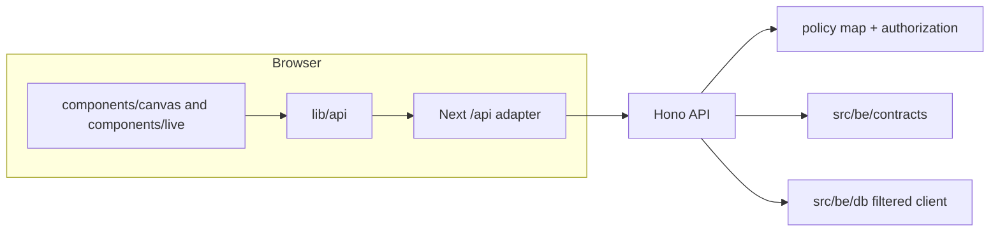
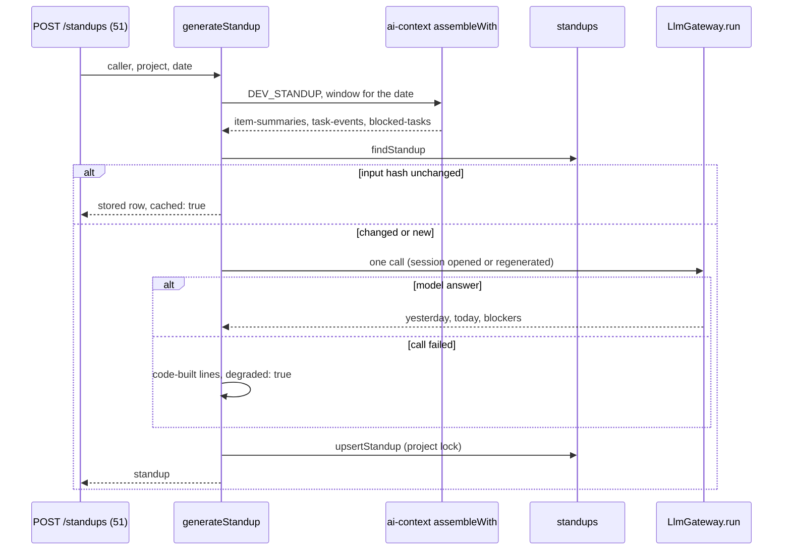
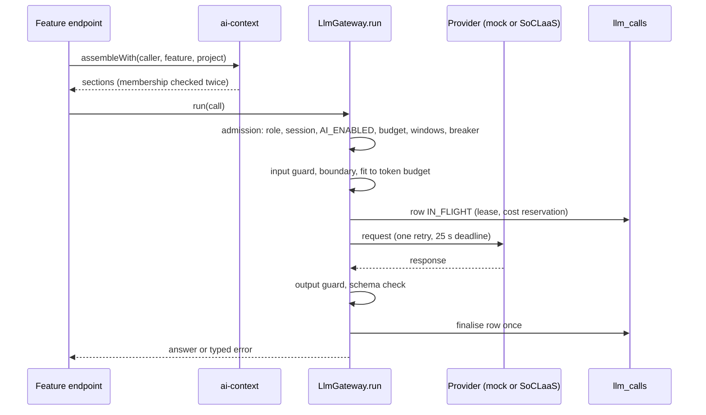

# 3. Architecture

The source-root split is `src/fe` for the Next.js frontend and `src/be/*` for backend packages. The web app lives at `src/fe`, not `apps/web` (C8/C24).

1. A screen calls a function in `lib/api`, for example `listTasks`. Sign-in and register call the API through `apiFetch`; the other screens still use the W10 fixture/store data layer.
2. Live requests enter through the minimal Next catch-all adapter and are forwarded to the Hono API.
3. The API registers route definitions through the shared `ROUTES` list, authorizes through the policy map, validates input with contracts, and uses the filtered Prisma client for database access.
4. Downstream workstreams provide principal lookup, resource resolvers, domain routes, and the remaining live frontend API functions.

## Core and role-feature path

`src/be/core` owns projects, memberships, epics, tasks, checkpoints, task events, planning
application, and the resource/context resolvers. It exposes `requireMember` and
`lockProjectForMutation`; the API composition root registers the core and its context sources.
Feature packages do not reach into core tables directly. The filtered database client remains the
visibility boundary, while core performs the domain and mutation checks (C48, C49, C80, C71).

The Dev Lead feature in `src/be/lead` reads only allow-listed facts, produces deterministic
forecast data, and stores digests with durable `factsAsOf` ordering. Its context source is
membership-scoped and its gateway calls use `assembleWith`; the compatibility migration is
expand/contract so old and new writers can coexist during rollout.

Production deployment is a separate protected path: `.github/workflows/w13-production.yml` runs
the checked-in migration wrapper with the production Environment, then invokes the Vercel Deploy
Hook only after migration succeeds. The workflow is push-only on `main`; Vercel Git deployment for
`main` is disabled and target identity/checksums are validated before Prisma runs (C85, C90, C93).

## Sign-in and registration

A request carries a Firebase ID token. `src/be/auth` verifies it, then looks up the caller in `users` for the application role. Registration (endpoints 2 and 3) is gated by a per-role registration code and a per-IP limit; the app refuses to start with unsafe auth settings.

In the browser (`firebase` mode), `AuthRoot` and `SessionProvider` hold the Firebase session and `AuthGate` gates every page on it; the role shown comes from `GET /api/me`, never from a cookie (C66). Only `@firebase/app` and `@firebase/auth` are used, loaded in `lib/auth/firebase.ts` (C64). `apiFetch` (`lib/api/http.ts`) is the only code that calls `fetch`: it attaches the ID token and accepts only same-origin `/api/` paths. Sign-in and register are live; the other screens still read fixtures until their workstreams wire them.

## Developer upload, summaries and standup (W9)

`src/be/dev` serves endpoints 49-52 and 55. A Developer uploads a JSON file of commits and pull requests (49); the items needing a summary are summarised in batches of up to 10 (50); the standup for a date is built from those summaries, the Developer's task events in the window for that date, and every task blocked now (51). Endpoint 52 reads one's own standup and 55 lists a project's standups for the Dev Lead.

1. The date is checked against the allowed standup days; a bad date is 422.
2. `assembleWith` reads the three sections; an empty window (00:00 Singapore time, tomorrow's date) still reads the current blockers (C74).
3. An unchanged input hash returns the stored standup with `cached: true` and records a cache hit; nothing is generated (C78).
4. Otherwise the stored session is regenerated (or a new one opened) and the gateway is called once.
5. If the call fails, the standup is built from task events and blocked tasks only and marked `degraded`; unsafe lines are hidden and flag it.
6. The row is written inside `inDevWrite`, which takes W5's project lock, returns 409 for an archived project and checks membership; exhausted write retries become 429 `RATE_LIMITED` (C71, C72).

## AI call path

Endpoints never call the provider or build their own context; they go through `assembleWith` and `run`. The mock is the default for tests, previews and CI; CI never calls the live service. Details: [4 Components](04-components.md).

**Rules:** `src/fe` never imports Prisma or `@agile/db`; screens import only from `lib/api`; route handlers do not check roles; and every route is represented in the contracts policy map (AD-01b, AD-55).

| Decision | Why | Ref |
|---|---|---|
| The page layouts reuse the canvas CSS and markup instead of Tailwind and shadcn | Matches the confirmed design exactly; rewriting every page by hand cost more for the same look | D1 |
| Source lives under `src/` | Course requirement | C8 |
| Contracts and policy are centralized in `src/be/contracts` | Prevents endpoint/schema/policy drift | C20 |
| Backend packages live under `src/be/*`; the old frontend scaffold is removed | Preserves the approved source-root and ownership split | C22, C23, C24 |
| The health adapter is the narrow frontend/backend exception | Makes `/api/health` reachable without taking ownership of the frontend implementation | C26 |
| Tokens are verified with `firebase-admin`; the role comes from our database | Vendor key rotation; roles are not claims | C50 |
| `requireMember` lives in `core` (W5), not `auth` | `core` owns `project_members` | C48 |
| Feature modules are workspace packages (`src/be/auth`, `src/be/ai-context`) | `src/be/api` may not import `@agile/db` | C51 |
| W2 builds the whole `run` path with a guard slot; feature owners register mock responses | W3 to W9 need a working gateway and mock | C27 |
| Untrusted sections are wrapped after fitting, with the security suffix in the user message | Truncate before wrapping; flagged input is marked, not blocked | C56 |
| `ai-context` is a source registry with membership through the frozen `Core` | Table ownership stays with the owning modules | C61 |
| `core` owns membership and resource resolution | Keeps project tables and authorization seams together | C48, C49, C80 |
| W5 mutation writes take the project-row lock | Archive and feature writes serialize on one lock | C71 |
| Production migration and deployment run only through protected CI | Prevents new application code from racing an old schema | C90, C93 |
| A real auth gate replaces the role cookie; the role comes from `/api/me` | The role shown must be the server's | C66 |
| The browser uses `@firebase/app` and `@firebase/auth`, not the `firebase` package | The full package pulls in a dependency with a high audit finding | C64 |
| The standup window is anchored to the standup date | A standup for tomorrow covers today, not the day before as well | C75 |
| An unchanged standup input returns the stored row, even when degraded | Contracts row 51 and AD-06; no repeat model call | C78 |
| W9 writes take W5's `lockProjectForMutation` | One lock that archive and every write contend on | C71 |

The implementation differs from the original W1 design in two documented seams: authorization runs before input parsing (D2), and route registration takes the app and dependencies while using the shared registry (D3). The minimal Next adapter is the approved frontend boundary exception (D4).
