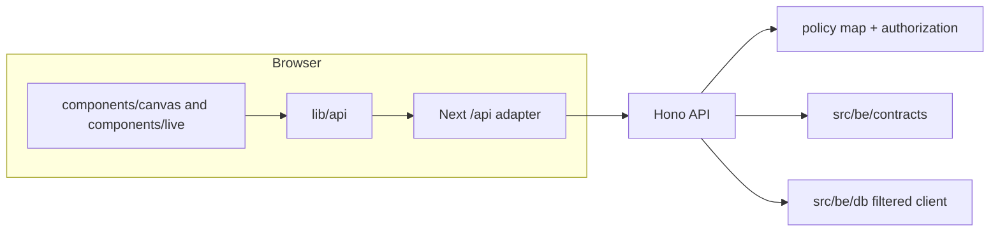

# 3. Architecture

The source-root split is `src/fe` for the Next.js frontend and `src/be/*` for backend packages. The web app lives at `src/fe`, not `apps/web` (C8/C24).

1. A screen calls a function in `lib/api`, for example `listTasks`. The W10 prototype currently uses its fixture/store data layer.
2. Live requests enter through the minimal Next catch-all adapter and are forwarded to the Hono API.
3. The API registers route definitions through the shared `ROUTES` list, authorizes through the policy map, validates input with contracts, and uses the filtered Prisma client for database access.
4. Downstream workstreams provide principal lookup, resource resolvers, domain routes, and the remaining live frontend API functions.

**Rules:** `src/fe` never imports Prisma or `@agile/db`; screens import only from `lib/api`; route handlers do not check roles; and every route is represented in the contracts policy map (AD-01b, AD-55).

| Decision | Why | Ref |
|---|---|---|
| The page layouts reuse the canvas CSS and markup instead of Tailwind and shadcn | Matches the confirmed design exactly; rewriting every page by hand cost more for the same look | D1 |
| Source lives under `src/` | Course requirement | C8 |
| Contracts and policy are centralized in `src/be/contracts` | Prevents endpoint/schema/policy drift | C20 |
| Backend packages live under `src/be/*`; the old frontend scaffold is removed | Preserves the approved source-root and ownership split | C22, C23, C24 |
| The health adapter is the narrow frontend/backend exception | Makes `/api/health` reachable without taking ownership of the frontend implementation | C26 |

The implementation differs from the original W1 design in two documented seams: authorization runs before input parsing (D2), and route registration takes the app and dependencies while using the shared registry (D3). The minimal Next adapter is the approved frontend boundary exception (D4).
