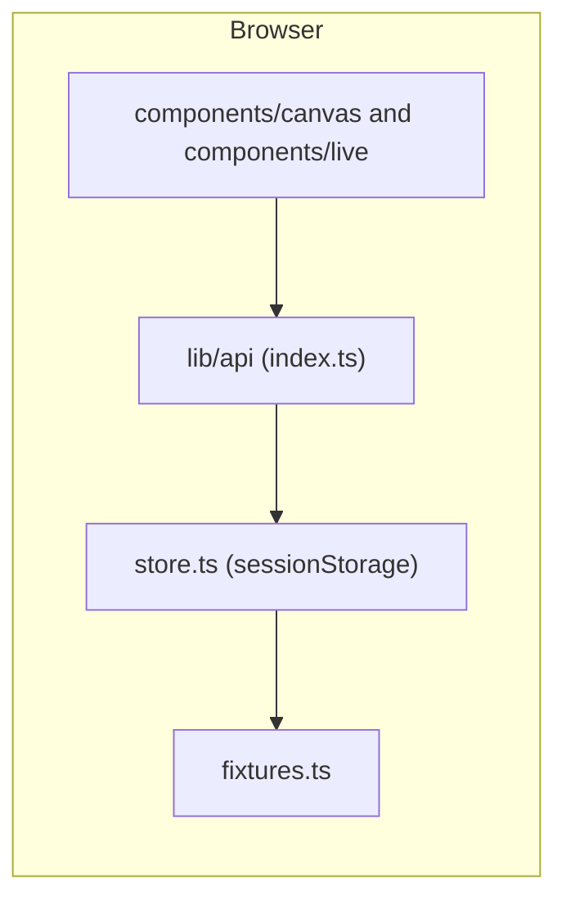

# 3. Architecture

Front end only (W10). The web app lives at `src/fe`, not `apps/web` (C8).

1. A screen calls a function in `lib/api`, for example `listTasks`. Each function is named for the endpoint it stands in for.
2. The function reads or writes the store, which keeps its state in `sessionStorage` under one key and starts from `fixtures.ts`.
3. The screen re-renders from `useDb()` when the store changes.

**Rule:** screens import only from `lib/api`. Nothing else may import `api/fixtures` or `api/store`; `npm run lint` fails if it happens. When the backend lands, only the `lib/api` functions change.

| Decision | Why | Ref |
|---|---|---|
| The page layouts reuse the canvas CSS and markup instead of Tailwind and shadcn | Matches the confirmed design exactly; rewriting every page by hand cost more for the same look | D1 |
| Source lives under `src/` | Course requirement | C8 |
